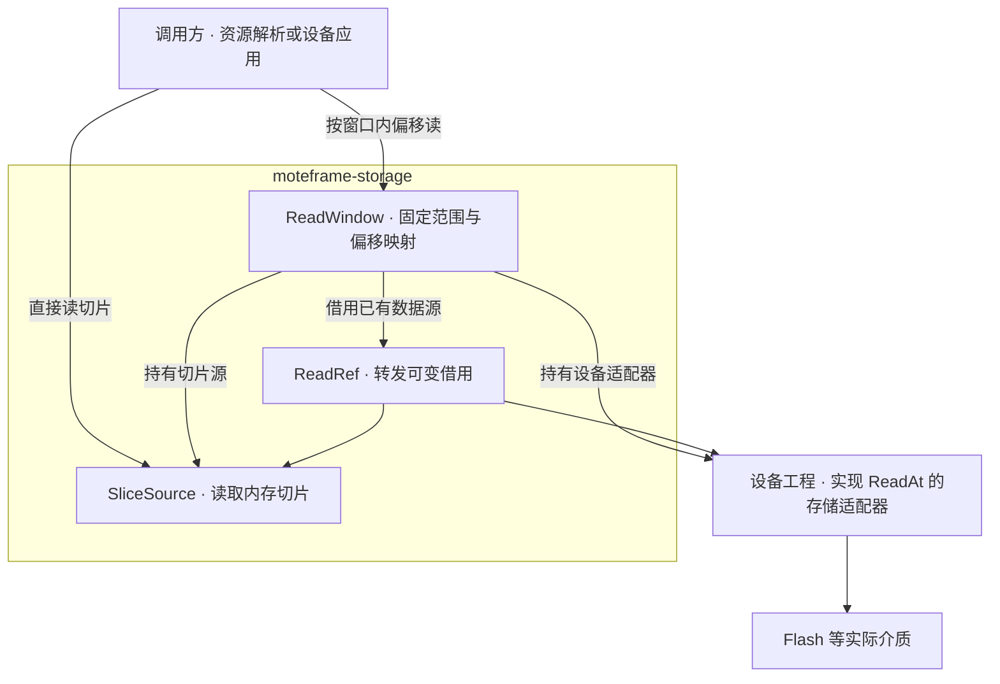

# moteframe-storage

Read-only byte views over the existing `moteframe_core::ReadAt` contract. The
runtime is `no_std`, allocation-free, and forbids unsafe code. It adds no
upstream dependencies and performs no hidden retry.

## 读取原理与架构

`moteframe-core` 定义按偏移读取字节的契约 `ReadAt`，包含 `capacity()` 和
`read_exact(offset, out)`。`moteframe-storage` 依赖 core，提供三个实现同一契约的类型。
调用方传入输出缓冲，读取成功表示缓冲已完整填满。下图的箭头表示读取时的调用方向。

例如资源分区从 `0x1000` 开始，长 `0x4000` 字节。用
`ReadWindow::new(ReadRef::new(&mut flash), 0x1000, 0x4000)` 构造窗口时，
会查询一次后端容量，确认整个区间可访问。随后在窗口偏移 `0x20` 读取 4 字节：

1. 窗口先检查逻辑区间 `[0x20, 0x24)`，并检查地址相加有无溢出。
2. 映射得到后端区间 `[0x1020, 0x1024)`，再查询后端当前容量。容量缩小时，仍在范围内的读取可以继续。
3. 通过检查后，`ReadRef` 向 `flash` 转发一次精确读取，数据直接进入调用方的 4 字节缓冲。窗口和借用包装都无需另配数据缓冲。

| 读取结果 | 调用方可依赖的行为 |
| --- | --- |
| 窗口范围无效 | 返回 `ReadError::Range`，输出缓冲保持原值。 |
| 窗口内或恰好在末尾读 0 字节 | 成功，跳过后端容量查询和读取。超过末尾仍报范围错误。 |
| 后端读取失败 | 返回 `ReadError::Source`，保留后端错误。缓冲可能已部分写入，调用方应丢弃整次输出。 |

### 与持久化的关系

启用 Cargo feature `config-store` 后，`snapshot::ConfigStore` 可作为 `DeferredConfig` 的介质后端。设备层先核对布局归属，提供两个独占、故障范围互不重叠的槽，实现 `write::SlotRegion<PAGE>`。每槽末页独占提交标记。上电时用 `ConfigStore::open` 扫描，再用 `load` 取回最新已提交的产品版本和原始字节；空白介质返回 `None`。应用解码并验证后，用该配置初始化 RAM。

运行期间在 RAM 应用修改，采集停止且取得足够长的 BLE 窗口后调用 `flush`。后端将新配置写入另一槽，回读核对后再提交。提交前断电仍可从旧槽加载。遇到无法解释的提交标记、已提交记录校验损坏或最新产品版本不受支持时，停止自动保存。FR8029D 的 QSPI 驱动已通过离线寄存器模型验证。配置保存时的板级授权、最坏擦写时延和 BLE 并发仍需按产品工况验收。[小型设备配置持久化设计](storage-config-snapshot.md)

## API contract

- `SliceSource` validates that an immutable slice fits the `u32` address space,
  reads exact checked ranges, and returns the identical slice with `into_inner`.
- `ReadRef` explicitly forwards a mutable borrow, including `dyn ReadAt`, without
  adding a blanket implementation to the core trait.
- `ReadWindow` owns a source and exposes a fixed logical subrange. Construction
  checks the full range using checked addition. A rejected construction retains
  the original source in `WindowCreateError`; `error()` borrows the reason and
  `into_parts()` returns the reason and source. Formatting that error requires no
  `Debug` implementation on the source.

Each nonempty window read validates its length and local/mapped range, then
checks the source's current capacity before one exact read. Source growth never
expands the window. Source shrink can reject affected requests while leaving
surviving requests readable. Empty reads at or before the logical end succeed
without querying or reading the source, including after shrink; past-end empty
reads fail. Slice and window range failures leave the output unchanged.

`ReadError::Source` preserves the original backend error. A failed backend read
may leave partial output, which callers must discard. Providers must finish
within a finite platform-defined budget and must not retain the output buffer.
A capacity check cannot prevent an underlying resource changing before the read;
the provider remains responsible for its own validation. `ReadWindow::into_inner`
and `ReadRef::into_inner` only transfer ownership or borrowing and make no backend
calls or recovery attempts. No view retains a payload buffer or makes a snapshot
of mutable external storage.

This crate supplies reusable read views, not physical Flash, write/erase drivers,
filesystems, codecs, catalogs, or persistence logic. Real hardware adapters and
product policies belong outside this repository. Host tests establish software
behavior, not Flash timing, device operation, or whole-firmware memory use.

License: Apache-2.0; see LICENSE and NOTICE.
