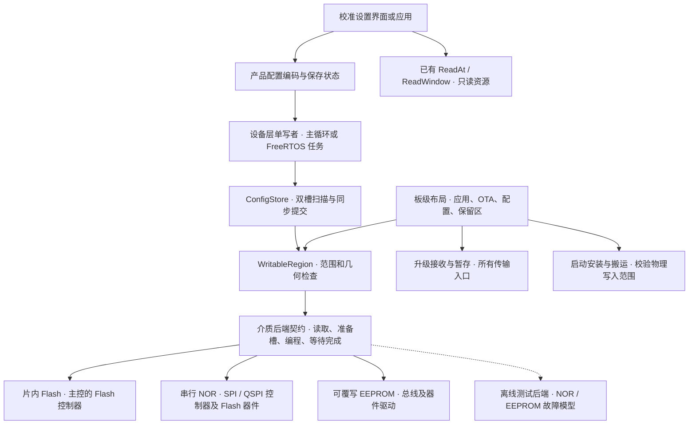

# moteframe-storage 小型设备配置持久化设计（V1 定稿）

**跨厂商 V1 设计已定稿，2026-11-27。** 双槽格式、介质后端契约与恢复规则作为实施基线。第 7 节列出板级写入放行条件和待执行回归。 本设计面向需要在完全断电后读回配置的小型设备。FR8029D 是首块参考板，有底层 Flash 擦写、恢复及回读实测记录。双槽配置保存已有 300 B 原型离线结果，512 B 是该参考产品的待验上限。第 4 节规定超时恢复入口和 DMA 启用条件，第 6 节给出参考板预算与最终产品镜像的验收方法。当前已实现的只读契约见 [portable-modules](../../specs/portable-modules.md)。

## 1. 首版范围与架构

一次保存一份有上限的配置快照。相关联的偏移量、比例系数和单位版本一起提交。产品负责字段编码、缺省值、数值校验和业务版本迁移。运行时目标为 no_std、无堆分配，裸机和 FreeRTOS 共用一种格式。高频采样日志、通用 KV 和 SDK FlashDB 磁盘格式兼容列为后续需求。



建议在 storage 增加可选 feature：`write` 提供可写分区，`config-store` 依赖 `write`。默认仍是只读，维持 `moteframe-core::ReadAt` 的方法和已有调用方式。QSPI、调度和芯片级互斥归设备工程；通用库不依赖 RTOS、SDK 或固定 Flash 地址。

### 跨厂商适配范围与验证状态

换主控时，产品可复用 V1 槽格式、提交顺序、扫描与恢复规则。板级适配器提供容量、擦除或准备单元、最小编程粒度、页边界、超时与复位行为；产品布局指定两个独占槽及升级保留区。即便同一主控也可以选板载启动 Flash 或独立的数据器件。槽长 S、提交区 U 及产品上限由具体布局确定。互读已有数据须保持该布局与产品编码一致。

| 平台或器件 | 适配评估 | 当前证据与接入差异 |
|---|---|---|
| 富芮坤 FR8029D 参考板 | 串行 NOR，经 QSPI 访问并从同片执行（XIP）。| 板上已读取 JEDEC ID、确认 1 MiB 容量，并完成受控擦写、恢复和全片回读。配置区地址、运行中保存及 512 B 掉电恢复仍待本板验收。[板级记录](../../devices/firmware/fr8029d-bringup/README.md) |
| 富芮坤 FR802x 其他型号，如 FR8026D、FR8028D | 可共用双槽层，优先评估复用 FR8029D 的 QSPI 控制器代码。| 厂家系列资料列出这些型号，FR802x SDK v0.3.6 提供按控制器和偏移寻址的 Flash 读、写、擦除接口。须按具体板核对实际 Flash、启动布局、写保护和忙时取指能力。当前为资料评估。 |
| 富芮坤 FR803x | 联合参考手册把 QSPI0 列为 Flash XIP，可沿用相同的后端契约。| 先核对目标型号和板级 Flash，再对照命令、状态位、复位和超时行为，决定哪些寄存器操作可复用。联合手册足以确定评估方向，具体型号的驱动兼容性与布局仍待核实。 |
| Nordic nRF52840 | 片内 Flash，由 NVMC 按页擦除、按对齐的 32 位字编程。| 按字组装尾部和提交标记。Flash 写入期间从 Flash 执行的 CPU 会停顿，板级须核对无线时序和超时路径。厂家资料评估。[Nordic NVMC](https://docs.nordicsemi.com/r/bundle/ps_nrf52840/page/nvmc.html) |
| ST STM32L476 | 片内 Flash。双 Bank 配置允许从一侧读取、在另一侧擦写。| 根据实际 Bank 配置与链接布局定位代码、中断及两个配置槽；同 Bank 访问仍可能停顿。厂家资料评估。[ST RM0351，第 3 章](https://www.st.com/resource/en/reference_manual/dm00083560-stm32l47xxx-stm32l48xxx-stm32l49xxx-and-stm32l4axxx-advanced-armbased-32bit-mcus-stmicroelectronics.pdf) |
| 乐鑫 ESP32-C3 | 主 SPI Flash，使用产品分区表分配专属数据分区。| 默认情况下，SPI1 操作期间缓存会关闭。板级应核对 RAM 中可执行的处理程序、中断、返回路径及 OTA 分区。厂家资料评估。[乐鑫 Flash 并发说明](https://docs.espressif.com/projects/esp-idf/en/latest/esp32c3/api-reference/peripherals/spi_flash/spi_flash_concurrency.html) |
| 带 I²C 的主控 + Microchip 24LC256 | 独立 EEPROM，支持 64 B 页写，写周期可用 ACK 轮询确认。| 驱动按页拆分并有界等待；重用目标槽时按第 4 节准备并回读整个提交区。属于跨主控的介质候选，实物掉电影响范围和寿命须按器件确认。[Microchip 数据手册，第 6–7 节](https://ww1.microchip.com/downloads/aemDocuments/documents/MPD/ProductDocuments/DataSheets/24AA256-24LC256-24FC256-256K-I2C-Serial-EEPROM-DS20001203.pdf) |

富芮坤评估依据为《富芮坤 FR802X 简介》（2025-12）的型号表、《FR802x_FR803x 参考手册》V1.5 第 45 页的存储器映射，以及 FR802x SDK v0.3.6 的 `components/driver/peripheral/Inc/driver_flash.h`。SDK 用于核对硬件行为。表中其他厂商是后端设计的适用性评估，本仓库的实板记录仅覆盖 FR8029D。

**共用取指介质时的写入条件。** 对所有会在配置擦写期间访问同一 Flash 或同一 Bank 的平台，启用写入前须证明控制器命令超时、介质仍忙两种情况下，等待代码、必需中断和返回路径都能在约定时限内执行。可依据具体平台使用独立数据器件、跨 Bank 读取或 SRAM 执行路径；证据不足时该板级组合仅启用读取。通用验收记录“写入许可、准备、编程、保护变更”等实际操作。后文的 WREN 是串行 NOR 的观测点，片内 Flash 对应控制器解锁或写使能，EEPROM 对应写事务。各板独立验收容量、分区、寿命及 RAM/栈预算。第 6 节的 152 B 静态余量只对应 FR8029D 的指定原型镜像。

## 2. 布局是启用写入的前提

FR8029D 参考几何为两个独立的 4 KiB 擦除块，共 8 KiB。FR8029D 的 1 MiB 产品布局 v1 已分配物理偏移 0x40000、0x41000；实际写入仍须核对部署的升级器及回退版本。[分区表与 OTA 上限](../../devices/firmware/fr8029d-bringup/README.md#fr8029d-1-mib-flash-分区-v1)板级布局必须给出设备容量、启动区和应用的最大范围、OTA 信息区、允许的暂存区及升级包上限、SDK 已有数据区和尾部保留区；由同一份布局生成或验证应用、OTA 和配置三方的边界。

- 区间一律采用半开形式；用受检加法计算末尾，验证容量、编程对齐和擦除对齐。两个槽不能共用擦除单元。驱动擦除取整后的实际范围也必须完全落在目标槽内。
- 板级表还须声明故障影响单元。EEPROM 可按字节寻址，而掉电影响范围可能是一整页；A、B 和相邻产品分区不能共用一次失败可能破坏的单元。无法给出此保证的介质拒绝启用双槽。
- SDK 外设示例在 240 KiB 处划出 16 KiB 的 FlashEnv。若产品仍需 SDK 数据，保留该区；迁移先用实物镜像验证。8 KiB 配置地址尚未指定。

### 所有配置写入共用的归属检查

由板级所有者根据受控刷机时绑定的板型/修订号，或运行时可验证的板级身份，选择已批准的布局清单。清单记录布局代际、介质和容量、A/B 基址、S、U、准备态、提交协议及允许写入的固件版本。核对当前设备几何、运行固件和所有可回退写入方与清单一致后，才向配置层授予该布局的写权限。板型有歧义、缺少历史布局记录或回退组合未批准时禁止擦写。受控单板构建可以使用固定清单，无须在空槽中写入身份标记。

归属检查先于槽状态判定，适用于首次初始化、正常保存和中断回收；复位或更换介质后重新确认。首版不支持在线改变槽基址、几何或提交协议。产品数据版本可以演进；改变布局须另行设计迁移和旧固件写权限交接。验收使用字节完全相同的两块空白模型：已批准板型可首次保存，未知板型、错误代际、未批准回退版本均为零擦写。

### 升级路径与板端门禁（P1）

OTA 是无线交付方式的统称，BLE、Wi-Fi 等可使用不同的接收协议；FR8029D 当前证据来自 SDK 的 BLE 示例。以下 Flash 隔离规则属于**固件安装流程**，同样适用于 USB、串口、离线包和维护工具。列举传输方式不代表本板已实现对应通道。

| 写入阶段 | 板级约束与拒绝时机 |
|---|---|
| 接收前联合预检 | 所有保留配置的升级入口在首次擦除或编程前取得同一份安装计划，绑定设备/布局、镜像身份和总长度、暂存范围、搬运目的区、复制单元、升级信息与进度区，以及工具的实际擦除策略。用受检算术按各阶段的擦除、复制和故障影响单元向外取整。逐项验证足迹均在各自获准范围内，且与两个配置槽无交集。任一参数未知、溢出或冲突时整次拒绝，暂存也不开始。 |
| 暂存与启动搬运 | 接收时每条擦写命令复核批准区间；发布启动标记前，从实际镜像和将要提交的启动元数据重新核对联合预检的参数，发生漂移则停止发布。可编程启动器在首次启动及断电续搬时复核同一计划。SDK 示例执行偏移为 0x2000，复制单元为 8 KiB；对不可修改的 ROM，须证明或隔离它在正常搬运、续搬、元数据更新和末块处理时的最大物理足迹。 |
| USB、串口、离线包和 J-Link 直写 | 对无暂存、无启动搬运的路径，计划须明确这两个阶段均不执行，同时验证所有目标段、补齐后的擦除范围及烧录工具的策略。“保留配置”和“允许整片擦除的显式维修”是互斥模式。即使文件地址合法，只要工具可能隐式整片擦除或无法确认策略，保留模式就拒绝启动。 |

协议在下载结束时才提供长度或搬运参数的，须先扩展协议或停用其保留配置模式。SDK 示例擦除分支仅校验起点下界，不能单凭主机校验认定旧升级器安全。逐版登记可运行的接收器、启动器、回退版本及维护工具；不可约束的组合只有在配置介质物理不可达或硬件隔离已验证时才可放行。参考 SDK 的 `examples/common/ota/ota_handle.c` 和 `ota.c::ota_reboot`。

### 升级断电验收与过程证据

1. **预检反例。** 暂存安全而搬运末块取整侵入 A、搬运安全而暂存侵入 B、进度区冲突、有线工具隐式整片擦除，均须在首条擦写前拒绝。取整后的半开区间恰好相邻可放行。若预检后启动参数变化，验证未发布启动标记。
2. **真实掉电。** 先在 A/B 两槽放入不同的非空已知记录并保存整槽基线。在暂存擦除/编程、启动标记发布、首次搬运、中间块、末块及进度更新阶段分别切断板端所有电源，覆盖重启续搬及续搬再次断电。直写工具按其真实擦除/编程阶段断电。逐轮记录版本、计划、触发点、上电后走的分支及最终结果。
3. **证明过程。** 可观测路径保存实际下发到介质的擦除/编程命令、地址、长度和结果，能识别整片擦除；从升级开始到断电，以及复电后的第一条命令起到完成，分别取证，按器件几何还原物理范围。对不可观测的 ROM 或复电盲区，必须验证隔离在复位及整个续搬阶段均有效，例如独立不可寻址的介质，或先在专用测试板上证实不可被该写入方解除的硬件保护。发现配置区写入尝试或证据链有盲区且无隔离证明时，该组合不通过。
4. **核对结果。** 每个断点在可能的最早只读检查点及升级收尾回读 A/B 和邻区哨兵，保留全片差异与两槽逐字节比较结果。先留存现场，再做维修还原。最终字节相同只能证明内容一致；“全程零擦写”还须满足上一项过程证据。未覆盖的升级器和回退版本仍列为未验证。

## 3. V1 格式提案

下表为冻结候选。固定小端，不持久化 Rust 结构体内存。槽大小和提交单元布局由板级格式配置确定；升级后须保持一致，改变布局需要独立迁移。设槽长 S，尾部保留独立编程区 U。U 至少容纳 4 字节标记且符合后端编程约束。如果禁止同页重复编程，U 独占整页。头和载荷按后端要求一次组装每个编程单元，尾部填充 0xFF，编程范围不得跨入 U。

| 槽内偏移 | 字段 | 规则 |
|---|---|---|
| 0–3 | magic | ASCII MFCF |
| 4–5、6–7 | 格式版本、头长 | u16，V1 分别为 1、28 |
| 8–11 | 产品配置版本 | u32，由产品声明可读版本 |
| 12–19 | 提交序号 | u64，首次为 1；达到最大值后拒绝递增 |
| 20–23 | 载荷字节数 | u32；先检查边界，再读取和计算 CRC |
| 24–27 | CRC | CRC-32/ISO-HDLC，输入为头部字节 0–23 拼接原始载荷，不含填充。反射算法，初值和最终异或均为 0xFFFFFFFF；“123456789”的校验值为 0xCBF43926 |
| 28 起 | 载荷 | 产品指定字节序与语义；最大长度同时满足槽容量、编程补齐和产品上限 |
| S−U 起 | 提交单元 | 起始四字节为 ASCII DONE，其余字节为 0xFF；准备态整个单元为 0xFF。有效提交要求完整单元匹配，并且头和载荷校验通过 |

黄金样本：产品版本 1、序号 1、载荷为小端 i32 的 −125。头和载荷共 32 字节：

```text
4d 46 43 46 01 00 1c 00 01 00 00 00 01 00 00 00
00 00 00 00 04 00 00 00 f2 5b 64 62 83 ff ff ff
```

对 S=4096、U=256 的测试夹具，其余字节填 0xFF，在偏移 3840 写入 44 4f 4e 45。CRC 用于检测意外损坏；设备身份认证或抗恶意篡改需另行设计。

## 4. 接口、写入顺序和结果

| 拟议操作 | 契约 |
|---|---|
| open(region, policy) | 只读检查两槽，返回选择结果、降级原因和写权限。policy 提供产品大小上限和支持的版本范围。遇到异常不自动格式化。 |
| load(out) | 按所选记录的已校验长度返回载荷、实际长度和产品版本。输出不足时告知所需长度，保持输出原样。后端读取失败时调用方丢弃整个输出。所有返回路径均须满足下述缓冲归还条件。 |
| save(version, bytes) | 同步、有界、无隐式重试。先检查长度上限，超限在任何写使能或介质变更前拒绝。版本、长度和全部载荷相同则零擦写。比较分块完成，读取旧记录使用旧头声明的长度。 |
| recover(&mut self) | 调用方持有原 ConfigStore，有界地检查之前的超时。返回仍待核对，或返回已核实的当前记录（允许无值）、写权限及降级原因。可以重复调用，全程不擦写，也不重放旧请求。 |
| into_inner() | 仅在后端可安全移交时归还分区及后端，无额外 I/O。仍有在途访问、隔离中的暂存或待核对的介质时返回忙，并保留原所有者供后续恢复。 |

写入步骤：验证写权限和参数 → 选空槽或较旧槽 → 准备目标槽并回读确认整个 U 全为 0xFF → 编程头和载荷 → 从介质读回并比对 → 单独编程提交区 → 重新扫描确认新槽可选 → 返回成功。全过程保留上一个有效槽。首次保存从 A 开始。若两个有效槽序号相同且记录逐字节一致，固定选择 A；同序号不同记录则禁止写入。

后端契约要求：准备、编程、读取均有时间上限；准备完成意味着目标槽可按声明几何重新写；编程成功意味着设备忙状态结束、读回能反映真实介质；同一次故障不会修改另一槽。EEPROM 复用槽时，先将整个 U 恢复为 0xFF，等待内部写周期结束，从介质分块回读 U 的每一个字节；确认后才准备其余区域。准备其余区域如可能影响 U，则在写新头前再次完整回读。任何一字节不符、读失败或仍忙都不得开始写头或载荷。只比较 DONE 四字节、只读缓存或把旧标记改成全零均不满足契约。读缓存、写缓冲、页边界及错误状态由适配器处理。

### 采集设备默认延后保存

裸机和 FreeRTOS 采用相同策略。产品层校验配置并成功应用后，立即向手机报告**已生效，待保存**。采集使用 RAM 中的新值；此时断电，重启会加载最近一次完整提交的配置，首次保存前使用产品默认值。BLE 写入应答只确认本次请求已受理。

**何时写 Flash。** 采集已停止，且 BLE 调度允许覆盖本次同步保存的最坏阻塞时间（含必要的扇区擦除、编程、提交与回读）时，主循环或单写者任务才调用 `save`。调度方须能在这段时间内推迟重新启动采集，并满足下一次无线事件的期限。仅观察到当前没有 BLE 包不足以判定窗口可用。窗口无法保证或板级写权限尚未放行时，保留待保存状态，零擦写。

**何时报告已保存。** 产品层跟踪当前生效配置与正在提交的那一版。等待窗口期间多次修改，只需保存最后生效的一版。保存期间固定本次提交的快照；只有重新扫描确认介质上的版本和完整载荷与当前生效配置一致，才向手机报告**已保存**。若期间又有修改，新值继续显示待保存。已发出变更命令但提交超时，保留 RAM 生效值并标记保存结果待核对，由原实例按下节恢复；重启以两槽扫描结果为准。

验收时先让配置 A 完成保存，再在采集中应用 B、C。确认设备使用 C，等待期间介质零擦写；此时断电应加载 A。另一次保持供电，采集停止但 BLE 窗口不足时仍应零擦写；窗口获准后保存 C，确认手机显示已保存，重启加载 C。

### 提交超时与介质完成屏障

保存成功只在重新扫描确认预期序号、版本及载荷后报告。已发出可能仍在执行的变更命令时，超时将**整颗介质**置为待核对状态，最终提交的结果为未知。阻止配置、升级和其他客户端继续擦写。调用方取回载荷或 MCU 单独复位后，门禁仍然有效。

**原实例如何恢复。** 返回超时后，主循环或 FreeRTOS 单写者保留原实例，随后调用 `recover(&mut self)`。待核对期间，普通加载、保存和取出后端均返回忙。恢复时依次取得介质独占访问，确认旧 DMA、描述符和回调均已停止访问或安全撤销，确认控制器及芯片空闲，核对错误状态，恢复一致的读映射，再完整扫描两槽。每次调用有时间上限。仍忙、读失败或不能确认内存安全时，保留隔离和原实例，下次可从该实例再次核对。

扫描成功后发布实际选中的槽、序号、产品版本和长度，并按第 5 节重新判定写权限。新值已提交便选新值，仅有旧值便选旧值，首次保存未提交则允许无值。发现冲突或损坏时报告降级原因并保持相应写限制。恢复只使用设备持有的状态和介质内容，调用方归还的载荷可随即改写。若需核对完整内容，可在恢复后用 `load(out)` 读取。首次打开也执行介质完成检查。跨复位只报告可验证的当前配置。

**同一实例的验收。** 分别模拟提交命令最终完成和未生效两条路径。`save` 返回超时后立即覆写输入缓冲。在控制器仍忙时调用 `recover`，应有界返回待核对，其他客户端零新擦写。放行控制器后，在原实例再次恢复，核对两种结局各自的序号和载荷。再次调用恢复须得到相同记录，恢复阶段的 WREN、擦除和编程计数均为零。最后在该实例保存另一份配置并重开校验，序号从恢复所选记录递增一次。

### DMA 完成、超时与缓冲归还（P2）

同步调用返回是调用方可以立即覆写、移动或释放缓冲的时刻。这条约定同时覆盖保存的输入、读取的输出以及错误返回。适配器分别记录“外设还会不会访问这块 RAM”和“这次提交是否已落盘”。只要可能发生晚到的内存访问，就不能归还被访问的缓冲。

| 发生的情况 | 适配器何时可以归还调用方缓冲 |
|---|---|
| CPU 同步搬运或 DMA 正常完成 | 最后一次 CPU 搬运结束，或控制器已确认 DMA 完成且不再持有该地址。交还前完成芯片要求的缓存同步和内存屏障，并确认描述符、中断和回调都不能再访问该缓冲。保存仍按上节规则等待持久化结果。 |
| 允许 DMA 直接访问调用方地址，传输超时或出错 | 驱动必须在约定时限内停用传输、确认通道静止、撤销描述符并处理或失效化待执行回调，之后才能返回。若该硬件没有可证明有界的停止路径，首版禁止对调用方内存直接启动 DMA。仅收到超时通知或读到 Flash 空闲都不足以归还。 |
| 停止时限无法保证，改用适配器暂存 | 写入先复制一页到设备所有的固定缓冲，读取先 DMA 到该缓冲，成功才由 CPU 复制给调用方。描述符与回调仅引用设备持有的内存。超时可释放调用方借用，设备所有者须保证暂存、描述符及回调状态地址稳定且存活，直至确认旧传输静止。隔离期间禁止复用、移动或释放这些对象，也不得受理新写。若已下发变更命令，另行执行介质完成屏障。 |

**离线验收。** 分别模拟读、写正常完成，超时后取消成功，以及超时后 DMA 和完成中断延迟到达。在 API 返回后立即复用调用方地址，用模型记录所有 DMA 读、写和回调触达的地址及请求代次。返回后对旧借用的访问数须为零。隔离中的暂存必须拒绝再次出借和 `into_inner()`，迟到的完成不能发布下一笔请求的结果。解除隔离后再成功保存一次，并验证“RAM 已安全归还但介质仍忙”期间全芯片零新擦写。

### 哪些复位和缓存条件允许 DMA

**复位条件对直接 DMA 和暂存 DMA 都适用。** M1 按板型分别登记产品可达的断电上电、整芯片复位、看门狗复位、软件复位及仅复位 CPU 的调试/重入路径。逐项记录 DMA 总线主控、在途写、描述符和挂起中断的复位范围，以及启动过程何时首次复用有关 RAM。FR8029D 的现有启动入口会在进入 Rust 前复制 `.data`、清零 `.bss`。仅屏蔽 CPU 中断不能证明 DMA 已停止。[FR8029D 启动入口](../../devices/firmware/fr8029d-bringup/src/startup.s)

| 首次复用 RAM 前可证明的条件 | 允许的路径 |
|---|---|
| 硬件复位已终止旧传输，未完成的总线访问已结束，旧描述符和中断无法再生效 | 可继续启动。记录适用复位类型和板级依据。启动后仍检查 Flash 自身的忙状态。 |
| 外设可能保留传输，但最早启动阶段能先隔离旧目标内存并有界地停用 DMA、排空在途访问、清理旧 IRQ 和回调 | 屏障完成后才可将相关 RAM 用作栈、复制数据、清零或重新分配。等待失败时保持隔离。须把 ROM 及早期启动对这些地址的使用纳入证明。 |
| 有可达复位路径无法证明上述任一条件 | 该板级配置使用 CPU 搬运。仅把 DMA 目标改成普通静态页缓冲，仍不能解决复位时该页被复用的问题。 |

**缓存条件按每次实际传输判断。** 直接 DMA 要求地址可达，并满足设备的对齐及读写方向约束。无数据缓存、硬件一致或位于已验证非缓存区的内存，按该区域的屏障要求处理。需软件维护数据缓存时，先把实际传输范围向外取整到缓存行。首尾在内的整个范围都须由本次传输独占，按硬件规定在启动前和完成或安全取消后完成相应的缓存维护，再交还内存。`load(out)` 的普通子切片不能自动证明相邻字节也被独占。条件不足时，改用地址对齐、大小按整行分配并独占的设备暂存，再由 CPU 复制实际长度。暂存也不满足时使用 CPU 搬运。暂存的填充字节计入 RAM。

**验证这两项条件。** 复位模型分别模拟复位会终止 DMA 和仅重启 CPU、保留在途 DMA 两种情况。在启动首次复用 RAM 前和首次 `open` 前后注入晚到写回与中断，核对新启动的 RAM 哨兵及回调计数。旧传输不得写入已重新分配的字节，也不得通知新请求。缓存模型用首尾未对齐的接收切片，在传输期间由另一任务改写同一首尾缓存行中切片外的哨兵。正常完成和可取消超时都必须保留这些更新，记录此时所选的暂存或 CPU 路径。另用独占整行的缓冲验证直接 DMA 分支。M3 核对目标板选用分支的实测或硬件依据。

## 5. 掉电恢复与写权限

写权限须先通过第 2 节归属检查，以下状态表不能授予未经批准布局的写权限。再对两个槽独立分类，再选最新有效记录。验证顺序为介质读取状态、提交状态、格式、长度、序号和 CRC。任何地址计算或长度错误均不得越槽读取。

| 观察结果 | 可读取内容 | 自动写权限 |
|---|---|---|
| 两槽均确认为全空白 | 首次使用，无值 | 归属检查通过后允许首次保存 |
| 两个有效槽 | 序号较大的记录 | 允许覆盖较旧槽；序号冲突按上一节处理 |
| 一个有效槽，另一个全空或符合下述回收规则 | 读取有效槽 | 保留有效槽，重新准备目标槽后从头写 |
| 首次写 A 中断、B 全空，A 符合回收规则 | 无已提交值 | 可重新准备 A，使用调用方重新提供的完整配置 |
| 介质未确认空闲、槽不可读 | 旧缓存不可作为持久化结果 | 执行完成屏障，失败则禁止写 |
| 已提交未知格式、最新产品版本越出可读范围（含过新或过旧） | 报告版本，允许产品显式导出或迁移 | 禁止默认值回写或退选旧槽后覆盖 |
| 完整提交标记但 CRC 错误、同序号不同内容、分区归属不明 | 若有有效副本可显式降级读取 | 禁止自动擦写 |

**跨页续写决策（P2）。** 选择板级排他分区方案。启用回收前须证明两槽由本产品独占，出厂布局已建档，所有允许升级/回退的格式均遵循同一固定位置和含义的提交区，且任何可见的已提交记录都必须有完整提交标记。归属由可信板级布局和产品生命周期保证，不能通过读取若干空白字节推断。无法证明时只允许降级读取。未来格式不能挪动提交标记后继续复用这片区域，须迁移或禁用旧写入方。

满足上述条件且整槽可读时，目标提交区全 FF 表示没有有效提交：即便头部或载荷不完整、载荷 CRC 失败，仍可回收。提交区部分编程时，仅接受介质契约能识别的未完成标记模式；其余异常进入只读降级。完整 DONE 的槽仍须按已提交规则解析，不得因 CRC 错误而自动回收。首次写只允许回收 A 且须 B 全空；正常更新必须保留完整有效源。此策略允许丢弃未提交目标内容，也可能丢弃提交标记本身已损坏且呈全 FF 的副本；若产品要求保全这类现场，需另配独立事务凭据。部分擦除遗留完整 DONE 和坏 CRC 的现场依旧保守锁写。

验收反例：256 B 页，28 B 头加 300 B 跨页载荷。写完第一页（228 B 载荷）、剩余 72 B 尚未写入即断电。重启读取 A；B 的提交区全 FF，允许用新请求从头重写 B。若第二次保存再次在此处掉电，仍可重复此过程。首次保存时用同样断点验证“暂无值→可再保存”。EEPROM 另从两个历史有效槽开始，在复用的 U 尾字节保留非 FF、模拟缓存仍为空或读尾失败，均应在写头前停止；随后用合格后端确认全 U 准备态，再做上述连续两次页间断电，第三次保存须成功。M2 对每次断点分别断言可读版本、下一次写权限及邻区内容。

## 6. 写入寿命、内存与 BLE 调度

### 寿命按最热单元验收（P2）

令 N 为产品寿命内内容发生变化的成功保存数上限（每日上限 D、年数 Y 对应 N≈365DY），E 为实际器件在规定温度和保持期的保证耐久度。板级预算应另计出厂/维修操作 F、失败损耗 R、安全系数 K>1。F、R 均按最热单元计；无自动无限重试，失败后重新保存也占预算。须限制单位时间内新保存/失败重试次数，反复重启不能当作新额度。产品无法给出跨重启的上限或外部约束时，不宣称达到目标寿命。

| 介质 | 建议验收式与证据 |
|---|---|
| NOR | 双槽交替时最忙块正常擦除量上界取 ceil(N/2)；对每块验证 K × (ceil(N/2) + F + R) ≤ E。建模同一备用槽反复失败，将该块每次实际擦除计入 R。 |
| EEPROM | 按数据手册的字节、页或内部耐久单元统计实际写周期；每次复用槽时提交单元至少涉及失效和最终提交两步，还须计入准备操作的额外编程。对每一热点单元验证 K × (正常编程次数 + F + R) ≤ 其额定次数。按页计费时，同页多次命令逐次计，不套用 NOR 的除二公式。 |

M1 取得器件型号、耐久规格和温度/寿命/频率输入，M2 输出每槽及每热点计数；M3 核对实测命令计数。没有额度的高频采样走独立日志设计。

### Flash 与 RAM 准入预算（P2）

建议 FR8029D 校准用例首轮产品载荷上限 P=512 B，编程/回读共用暂存上限 Q=256 B，待实际几何及校准字段确认。3812 B 是格式夹具能容纳的载荷。按 P、Q 设计时，同时活跃的载荷和单页暂存最多 768 B。控制状态、对齐、调用栈及在 SRAM 执行的代码另计。

**512 B 配置由产品校准模块持有。** 裸机由主循环、FreeRTOS 由单写者任务调用保存。产品在自己的缓冲中完成编码，将实际长度的切片独占借给 `SaveRequest`。从计算 CRC 到回读比对期间，生产者、其他任务和外设都不得再修改它。执行者消费请求，按第 4 节的条件返回借用。存储层复用一页 Q 完成 CRC、比较及编程。若 Q 也供 DMA 使用，须验证地址稳定性、可达性、对齐及隔离期寿命；若适配器另需一页，按实际大小追加预算。

设备层最多受理一个请求，覆盖待写、执行和结果未知期。首版允许产品延后发起保存，随后在所有者上下文同步调用。跨任务排队如需保留提交当时的值，须移交固定缓冲的所有权直至完成或安全取消，并计入队列和在途存储；不得排队保存栈切片的地址。M1 必须指明真实产品对象、容量、所在段或所属任务栈及存活期。只有基线与接入版都包含同一份可用编码缓冲时才可抵扣。若产品同时保留结构化配置和编码副本，两份都要计入峰值。

| 资源 | 预算和验证 |
|---|---|
| 程序 Flash | 两种运行时各自产出相同工具链、相同 BLE 配置的只读基线、write、config-store 镜像。建议初始评审上限：完整配置功能相对各自基线增加 ≤8 KiB；同时必须能装入给 OTA 预留增长后的应用区。8 KiB 双槽另计入非易失数据。 |
| RAM | 建议完整功能新增静态与常驻 RAM（含上述缓冲）≤1 KiB。分列 .data/.bss、移至 SRAM 的代码、任务对象及额外预留栈，避免重复计数；检查最坏并发总量后整机仍有板级要求的空闲 RAM。 |
| 栈与实时性 | 建议裸机主栈、FreeRTOS 存储执行任务和中断栈分别保有 ≥max(256 B, 各自预留的 20%) 余量。用实际保存、超时恢复、BLE 并发路径的填充水位配合静态帧核对。若共用 BLE 任务也要按该任务栈核验。测单次擦除/编程和整次保存，核对产品允许的 BLE 最大阻塞。 |

数值供 M1 评审。两种运行时分别签核整机空闲 RAM 下限与 BLE 时限。超预算须缩小 P、调整后端或重新评审。擦写只在主循环或单写者任务执行。

### 300 B 双槽原型的离线验证（2026-11-27）

以提交 `be0cd91` 的 Cortex-M33 标准事件驱动 BLE Release 固件为基线。旧原型为测试载荷常驻分配 300 B；接管版直接使用已有载荷，保留 256 B 页缓冲。下表的 Flash 为应用载荷，两个 4 KiB 配置槽另计。基线与接管版使用原链接脚本；旧 FreeRTOS 原型的数据来自上一轮放宽链接窗口的对照副本。

| 运行时与方案 | 程序 Flash（B） | 静态 RAM（B） | 总栈预留（B） |
|---|---:|---:|---:|
| 裸机 · 无存储基线 | 67,940 | 264 | 22,272 |
| 裸机 · 常驻载荷原型 | 69,220 | 824 | 22,272 |
| 裸机 · 接管调用方缓冲 | 69,260 | 520 | 22,272 |
| FreeRTOS · 无存储基线 | 71,228 | 616 | 19,200 |
| FreeRTOS · 常驻载荷原型 | 72,508 | 1,176 | 19,200 |
| FreeRTOS · 接管调用方缓冲 | 72,540 | 872 | 19,200 |

相对同运行时的常驻载荷原型，两版静态 RAM 都节省 304 B，包含链接对齐变化；程序 Flash 分别增加 40 B 和 32 B。FreeRTOS 的静态区原上限为 1,024 B，从超出 152 B 变为剩余 152 B。两种接管版均按原预算链接通过。

**调用栈。** 在模拟器中执行各自 ELF 的 ARM 存储入口，用栈填充写痕测量 41 次变化配置保存。裸机与 FreeRTOS 结果相同：旧原型入口最高触及 240 B；接管已有缓冲的入口为 248 B；从调用方临时在栈上生成 300 B 配置到保存返回，整条调用链为 568 B。后两项是同一路径的两种测量起点，不能相加。表中的栈预留是链接布局；真实 QSPI 等待、BLE 中断和任务调度时的整机栈余量仍待 M3 测量。

**连续两次跨页中断。** 用两个 4 KiB NOR 擦除块和 256 B 编程页，先提交旧值，再两次尝试保存同一份 300 B 新值。每次都在备用槽第一页完成后中断，28 B 头与 228 B 载荷已落盘，剩余 72 B 和提交区仍为擦除态。每次重启丢弃模拟 CPU 与 RAM，仅保留 NOR。裸机和 FreeRTOS 的 ARM 镜像都执行了保存和重试。主机独立解析器确认两次中断后均保留完整旧值，第三次保存后的序号、CRC 和全部 300 B 新值一致。该试验未执行产品启动时的 `load(out)`。独立的主机试验从空白开始正常更新 1,000 次，两槽各擦除 500 次。

### 双槽实现和测试代码的 Flash 占用

FR8029D 事件驱动标准 GATT，Release、LTO、相同链接脚本。依次测量 BLE 基线、调用方提供 300 B 缓冲的双槽保存/加载入口、包含 A/B 输入和结果检查的完整回归镜像。后两组均使用相同的 2 × 4 KiB 模拟 NOR。下表为 ELF 可加载字节，含 SRAM 初始数据在 Flash 的副本。服务增量包含介质适配与调用入口；完整镜像再增加的字节是替换为完整测试流程后的净差，LTO 会合并和内联函数。

| 运行时与编译开关 | BLE 基线 | 含双槽入口 | 完整 A/B 回归 | 原预算 |
|---|---:|---:|---:|---:|
| 裸机，原 XIP | 67,940 B | 70,588 B | 71,148 B | 69,632 B |
| 裸机，紧凑 XIP | 64,468 B | 66,924 B | 67,492 B | 69,632 B |
| FreeRTOS，原 XIP | 71,228 B | 73,868 B | 74,436 B | 73,728 B |
| FreeRTOS，紧凑 XIP | 67,500 B | 69,964 B | 70,524 B | 73,728 B |

原裸机余量 1,692 B，双槽入口增加 2,648 B，完整测试流程另增 560 B，合计超出 1,516 B。原 FreeRTOS 余量 2,500 B，对应增加 2,640 B 和 568 B，超出 708 B。启用 `ble-gatt-xip-compact` 后，完整回归镜像分别还余 2,140 B 和 3,204 B。生产 QSPI 适配器需替换模拟介质后重新链接。

两套编译开关下，三组镜像的静态 RAM 均为裸机 264 B、FreeRTOS 616 B。另有诊断区各 256 B，预留栈分别为 22,272 B 和 19,200 B。双槽入口使用模拟调用方已持有的 300 B，不计入 ELF 静态区；产品须按实际所有者计入。模拟器以栈填充值测首次提交、推迟写入、重新加载、第一页中断和重试。两版双槽入口的最大写栈深度均由 832 B 降至 824 B；完整测试入口均由 1,488 B 降至 1,480 B。结果不包含 BLE 并发、中断嵌套或 FreeRTOS 调度栈峰值。

### FR8029D QSPI 后端离线对照

在同一套紧凑 XIP、事件驱动 GATT 配置下，分别链接模拟 NOR 和 FR8029D 的 QSPI0 驱动。两套镜像都保留同一个可从模拟器调用的入口。服务入口复用调用方的 300 B 缓冲，完整回归入口另带测试数据和断言。各列均以字节计，箭头表示模拟 NOR → QSPI。

| 运行时 | 服务 Flash | 完整回归 Flash | 静态 RAM | 服务入口栈写痕 | 完整回归栈写痕 | 总栈预留 |
|---|---:|---:|---:|---:|---:|---:|
| 裸机 | 68,264 → 69,160 | 68,520 → 69,344 | 600 → 608 | 872 → 912 | 1,224 → 1,272 | 22,272 |
| FreeRTOS | 71,288 → 72,192 | 71,544 → 72,368 | 944 → 952 | 872 → 912 | 1,224 → 1,272 | 19,200 |

本次复测使用含启动写保护的 XIP 基线，完整测试逐字节比对回读的 300 B。QSPI 服务距 68 KiB 和 72 KiB 的 Flash 上限分别余 472 B 和 1,536 B。两种后端均链接启动写保护所用的 SRAM 命令例程；接入 QSPI 后静态 RAM 各增加 8 B。FreeRTOS 的 1,024 B 静态窗口余 72 B。服务镜像假设调用方已经持有配置缓冲，产品若新增常驻缓冲必须另计。模型直接执行 ELF 的存储入口，重建 CPU 和 RAM 来模拟断电；栈写痕覆盖本次存储调用，整机任务切换、中断嵌套和真实擦写耗时还需单独验收。

模型确认两个 4 KiB 槽各自独立。非法分区和器件 ID 不匹配时零擦写；采集期间和预留窗口不足时，RAM 新值生效，Flash 仍读回旧值。保存 B 时连续在第 1、256、512 个编程字节中断，每次重启都能读回 A，最后一次重试成功后再重启能完整读回 B。模型检查擦除地址、编程页边界、相邻区域和正常完成时的写保护。窗口数值为模型输入，产品须单独确定安全窗口及物理分区所有权。[板级接入与复测入口](../../devices/firmware/fr8029d-bringup/README.md#双槽配置的-qspi-后端)

### FreeRTOS 静态区剩余 152 B 的验收（P2，待执行）

872 B 由 220 B 的 `.data`、648 B 的 `.bss` 和 4 B 对齐组成。152 B 仅指 300 B 原型在原 1024 B 静态窗口内的余量。举例说，若其余布局不变，再新增独立的 512 B 常驻数组，至少需要 1384 B，超出窗口 360 B。这个方案即使相对 616 B 基线只增加 768 B、满足功能增量门槛，也不能通过链接验收。

1. **冻结预算。** M1 由板级维护者给出此窗口须保留的字节数，并另列整机空闲 RAM 下限。对完整产品镜像同时检查「静态区实际占用 + 签核的预留 ≤ 1024 B」和上表功能增量预算。预留未定或任一超限时，512 B 配置保持待验收。
2. **核对链接。** M2 对裸机和 FreeRTOS 使用原链接脚本、相同 BLE 配置和工具链，分别留存基线与完整配置的 ELF、map 和差值。逐项定位产品载荷、Q、DMA 描述符及额外暂存、队列/在途状态、段间填充。栈上对象登记到对应栈；在专用 SRAM 段的对象核对地址、上限及整机占用。300 B 原型由测试调用方提供载荷，不能据此认定产品已预留 512 B。链接失败或通过扩大窗口、缩小预留栈才装入，均须重新评审。
3. **核对峰值。** M2 用实际 512 B 编码、保存、加载及超时路径量调用链。M3 在真实 QSPI、BLE 并发、中断抢占和超时恢复下分别记录水位。FreeRTOS 原布局的 BLE 任务栈 16384 B、MSP 1792 B、Idle 栈 1024 B 逐栈验收；如另设存储任务也单列。裸机单列 MSP。每个栈须保留上表规定的余量，并满足整机 RAM 和 BLE 时限。不得把静态窗口的 152 B 算作栈余量。留存镜像标识、链接窗口、实际峰值和剩余字节后才签核。

**最终产品镜像签核（M4）。** 裸机、FreeRTOS 各留一份记录，将发布镜像的 SHA-256 与对应 ELF、map、板型、链接脚本、构建选项、BLE/QSPI/DMA 配置关联。记录 512 B 载荷与暂存的实际所有者、容量、段或任务栈，执行编码、解码和保存的任务，以及各栈预留、水位和整机余量。M2 链接数据和 M3 水位记录须能追溯到同一份待发布镜像。若使用带诊断的构建，须说明与发布镜像的差异，未证明等价的资源项在发布镜像上复验。

M4 用实际接入校准模块的镜像逐项比对签核记录。镜像摘要变化时重新核对 ELF 与内存布局。所有者、编码副本、任务、调用链、驱动或构建选项变化时，重跑受影响的 M2 链接/栈核对及 M3 逐栈水位、整机余量和 BLE 并发测试，用新记录签核。无法说明影响范围时两阶段都复验。测试夹具和 300 B 原型的数据仅作对照。

按上表余量门槛且按 4 B 读数向上取整，当前 FreeRTOS 布局至少须剩 BLE 3280 B、MSP 360 B、Idle 256 B，裸机 MSP 至少须剩 4456 B。栈预留变化时按实际值重算。验收逐栈比较并保留结果。现有 SRAM 试验脚本默认只对 BLE 栈自动检查 512 B，单独通过该检查不足以签核。[现有水位检查](../../devices/firmware/fr8029d-bringup/tools/gatt_notify_sram_trial.tcl)

### 512 B 变长快照与断电验收（P2，待执行）

M2 在裸机和 FreeRTOS 两份 ARM 镜像上分别执行以下矩阵。使用相同的 2 × 4 KiB NOR、256 B 编程页和独立提交页。28 B 头加 512 B 载荷正好使用三个数据页，载荷依次为 228、256、28 B，第三页完成后才单独写 DONE。各代载荷采用可逐字节核对的不同内容，包含非 FF 尾部。

| 用例 | 注入点与通过条件 |
|---|---|
| 连续两次断电 | 用 `(i,j)` 表示第一次尝试写完数据页 i 后断电、重启重试写完页 j 后再次断电。覆盖 i、j 各取 1、2、3 的九种组合，页 3 断点在写 DONE 前。分别从空白和已有有效旧值开始，已有值时轮换 A、B 为目标。每次只保留 NOR，重新创建 CPU、RAM、驱动和请求；先 `open/load`，应为无值或原序号的完整旧值。第三次重新提供全部 512 B，须成功提交，序号恰好递增一次（首次为 1）。再重启读取新值。两次失败期间已有有效槽及邻区哨兵逐字节不变。 |
| 断电后换载荷重试 | 在上述 `(3,1)` 组合用同一产品版本、长度均为 512 B 的三份不同配置。第一次写完第三页、头和载荷 CRC 已可校验且整个提交区仍为准备态时断电，第二次改交另一份，写完第一页后再断电，第三次再换载荷并完成。三份内容的 CRC 各异，已写过的第一页在相邻两次请求间各有至少一个位须由 0 变 1。每次重启先按上一行核对旧值或无值，再从头准备目标槽。最后用固件 `load(out)` 和独立解析器核对全部 512 B 等于第三份，序号只加一，首次为 1。未提交头里的 CRC 不得限制下一次请求的内容。 |
| 长短配置换代 | 依次保存 228 → 512 → 229 → 485 → 484 → 511 → 512 B，每次跨槽重开。长短切换包括“新值等于旧值的前缀”和“前缀相同、仅增长尾部”两种情况，均须生成新序号。用已批准的两个产品版本分别验证同值同版本零擦写、仅版本变化仍提交。每代由固件 `load(out)` 和独立介质解析器交叉核对槽号、序号、记录长度、版本、CRC 和载荷（固件接口核对其返回字段）。短值只能返回实际长度，足量输出的尾部哨兵不变。输出短 1 B 时报告所需长度，整个输出保持原样。 |
| 512 B 只改最后一字节 | 接着上一行最后一份已提交的 512 B，保持产品版本和前 511 B 不变，仅翻转索引 511 的一位。保存必须切换到另一槽，序号恰好加一。冷启动后以固件 `load(out)` 和独立解析器逐字节核对新配置，特别核对第三页的最后一个载荷字节。再次保存这份相同的新值时零擦写。 |
| 513 B 拒绝后原实例立即保存 | 分别从空白、已有有效记录发起 513 B 保存，均在首条 WREN 前返回长度超限。单独统计该调用，写使能、准备/擦除、页编程、提交及保护变更次数全部为零，两槽与邻区逐字节保持请求前的内容。保留此时的 NOR 快照。原实例直接发起内容有变化的合法 512 B 保存，中间不重开、不恢复、不清请求状态。必须成功，空白起点的序号为 1，已有记录的序号为旧序号加一。冷启动后核对合法新值。另从拒绝时的快照独立冷启动，核对仍无值或仍是原序号和旧值。 |

每组保留镜像标识、载荷长度、断点或拒绝原因、命令计数、重开读数及介质比对结果。512 B 的离线功能验收须由两份镜像全部通过。实际 DMA、QSPI、整机栈水位与真实掉电留到 M3 独立签核。

## 7. 实施与验收顺序

| 阶段 | 交付与通过条件 |
|---|---|
| M1 板级输入确认 | 确认板级地址归属、SDK 数据兼容目标、真实 512 B 配置所有者、各复位路径和内存区域允许的 DMA 模式、完成与取消能力、板级静态预留、寿命输入和 BLE 保存时限。校验格式黄金样本与读写权限表。条件未齐时可做模型，暂不上板分配地址。 |
| M2 离线 | NOR 与 EEPROM 模型共用验收。覆盖每次准备、页编程、提交前后及结果未知；从每个可自动恢复现场再保存、再中断。检查最终为完整旧值或新值；首次写时允许无值。对不可解释现场检查保留有效副本且零擦写。加入首个完整页后两次中断、提交延迟跨两次 reopen（全芯片零新写）、同备用槽重复失败的热点计数、未知版本、半页、部分擦除、同序号冲突、同值零写入、邻区哨兵，以及第 2 节联合预检、未知布局空槽零擦写和 EEPROM 整个 U 的准备态反例。 |
| M2 V1 专项验收 | 第 4 节原实例恢复、DMA 超时、复位与缓存模型通过。两种运行时按第 6 节执行 512 B 矩阵、原窗口链接与离线栈核对。记录对应镜像及产品配置。 |
| M3 FR8029D | 实验分区获确认后，在裸机与 FreeRTOS 上测真实断电、重启选择、邻区完整性和 BLE 时序。用所选适配器验证第 4 节的缓冲归还条件，按第 6 节签核实际栈水位与整机余量。调试器断开与断电分别记录。按第 2 节逐升级组合归档断电与续搬过程证据、槽回读和邻区差异，另输出三档资源差值、寿命预算和恢复基线。 |
| M4 产品接入 | 接入真实校准参数，按第 6 节核对最终产品镜像与 M2/M3 记录，完成变更项复验后签核 RAM 和各栈余量。确认版本迁移、降级策略、用户可见保存状态及恢复出厂设置的显式入口。 |

### P1 · 共用程序 Flash 时的超时返回（板级待验证）

FR8029D 现有只读探针在 QSPI 命令轮询超时后仍等待 `CMD_BUSY` 清零，以便安全返回 Flash 中的调用方。该实现无法作为配置写后端有界返回的依据。V1 已确定第 1 节的跨厂商放行条件。FR8029D 同片 XIP 配置写入在以下证据齐备前保持关闭，离线实现和验证可先行。[板级 QSPI 事务](../../devices/firmware/fr8029d-bringup/src/cold_radio.rs)

**何时需要处理这个 P1。** 产品允许延后持久化，且有经过实测、满足基本超时和恢复契约的空闲写入窗口时，首版采用第 4 节策略，可以推迟“边采集或通信边擦写”的 SRAM 改造。若要求持续采集或保持 BLE 时限的同时限时落盘，或实测最长擦除会跨过无线事件、传感器 FIFO 耗尽时间或调用方期限，就须在开放该场景前解决 P1，或改用独立数据介质。即使采集已经停止，若同片 XIP 在控制器超时或 Flash 仍忙时无法满足该窗口的返回约定，该板仍须先解决 P1 才能启用该写入路径。

- [ ] **M1/M2，板级适配负责人。** 给出产品允许的超时和中断延迟上限。在裸机及 FreeRTOS 的最终 ELF 上，从发出命令追到调用方取得结果，核对等待代码、计时源、常量、中断向量和必要处理程序在忙期间均可用。若采用 RAM 执行，将搬入的代码与数据计入第 6 节预算。
- [ ] **M3，按镜像分别放行。** 在获准的实验分区分别覆盖①控制器命令超过时限仍忙，②控制器已空闲、NOR 内部擦写仍忙。记录忙状态、调用耗时、中断延迟和介质命令。调用方须在限时内取得待核对结果；隔离期间其他客户端零新擦写。故障解除后，在原实例执行 `recover()`，核对选中的完整记录，再成功保存。将日志绑定到第 6 节的镜像摘要。任一状态无法验证时，该组合继续只读。其他平台按实际取指路径独立签核。

### 五项 P2 实施验收清单（待执行）

- [ ] **M2 · 恢复扫描中途读错。** 构造旧槽 A、新槽 B，B 实际已提交。让原实例在控制器空闲后读 A 成功、读 B 一次失败。`recover()` 应返回待核对，`load/save/into_inner` 均忙。其他写入方实际请求时，底层零新擦写。解除读错后由同一实例选回 B，核对序号和全部载荷。
- [ ] **M2 · DMA 暂存所有者移动或销毁。** 让 DMA 超时且仍持有暂存，分别走安全 API 允许的句柄移动与释放路径，再尝试复用句柄原地址并注入晚到 DMA 和中断。旧传输静止前，暂存、描述符和回调状态地址稳定且存活，复用地址不被旧请求访问。由类型系统禁止的路径以编译期用例验收。
- [ ] **M2/M3 · 复位期间旧 DMA 读取。** 在第 4 节的复位模型中加入 RAM 到外设的发送方向。仅复位 CPU，保留在途传输，令启动代码准备复用源页。按请求代次记录 DMA 读写地址及外设实际收到的数据。RAM 复用后旧请求读写均为零，新页字节不得进入旧事务。M3 核实目标板选用的复位分支。
- [ ] **M3/M4 · 冷启动解码栈峰值。** 在最终镜像中预置可读的 512 B 配置，从复位测到产品校准值生效，记录实际执行解码的 MSP 或任务栈水位；支持旧版迁移时覆盖最深的一条迁移路径。按第 6 节逐栈门槛验收，水位、镜像摘要和配置版本一起归档。
- [ ] **M2 · 写完三页、提交前换载荷。** 两份 ARM 镜像执行第 6 节的 `(3,1)` 用例。留存首次断电时载荷 CRC 有效且提交区全 FF 的快照；第二次换值并在第一页后断电。第三次再换值后提交，冷启动逐字节读回第三份，序号只加一。此前的有效槽和邻区哨兵在失败期间保持原样。

**各产品实施前须确认的输入**包括是否必须读取现有 SDK FlashEnv；8 KiB 的确切归属及未来 OTA 上限；产品寿命、温度范围和每日写入上限；产品是否批准 P/Q 和两种运行时资源门槛；BLE 连接时允许延迟多久；能否承诺专属分区及跨版本提交区协议，并接受其回收与降级边界。以上是实施输入，未作为已验证的硬件结论。
