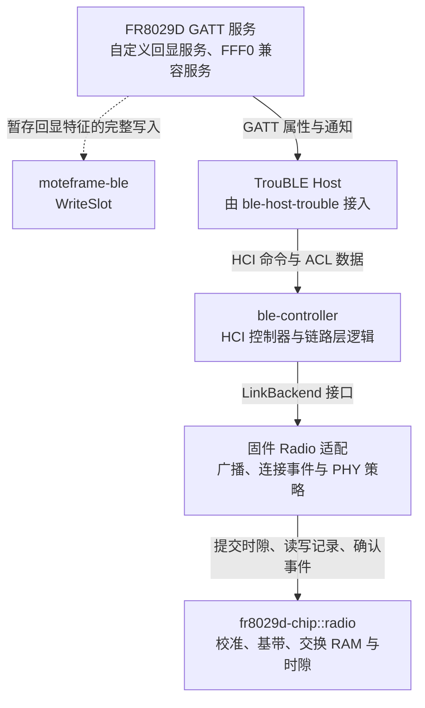

# FR8029D 板级启动探针

这个工程用 Cortex-M33 裸机 Rust 探针验证 Boot ROM 到应用入口的交接，读取启动寄存器，并把结果放在应用 SRAM。`probe` feature 启用基础探针的固件入口。默认构建只包含可在主机测试的寄存器字段解析和 Packet RAM 地址检查。厂商 SDK、ROM 反汇编和原厂镜像只用于取证。

硬件文档按范围查阅：[多厂商适配架构](../../../docs/architecture/hardware-support.md)、[富芮坤型号能力表](../../chips/freqchip/README.md)、[FR8029D 板载功能与实测状态](../../boards/fr8029d-evb/README.md)。

## 构建与检查

在本目录运行。

```sh
rustup target add thumbv8m.main-none-eabi
cargo fmt --check
cargo test --offline --locked
cargo clippy --offline --locked --all-targets -- -D warnings
cargo clippy --offline --locked --release --features probe --target thumbv8m.main-none-eabi -- -D warnings
cargo build --offline --locked --release --features probe --target thumbv8m.main-none-eabi
```

产物为 `target/thumbv8m.main-none-eabi/release/fr8029d-bringup` ELF。可用 `llvm-objdump --private-headers --section-headers --syms -s -j .vectors <ELF>` 检查段和向量，再用 `llvm-objdump -d <ELF>` 查看入口和栈帧。

## 离线测试包与恢复验证

在本目录运行打包工具。两个输入是同一块板的两份 1 MiB 只读 Flash XIP 采集，输出目录由脚本新建。

```sh
python3 -B -m unittest discover -s tools -v
python3 -B tools/pack_probe.py \
  --original "$first_capture" \
  --repeat-capture "$repeat_capture" \
  --elf target/thumbv8m.main-none-eabi/release/fr8029d-bringup \
  --output "$package_dir"
```

工具依据实测的主启动头格式更新应用长度、应用 CRC 和头 CRC。输出 `sector-02000-probe.bin` 和 `sector-00000-probe.bin` 对应物理 Flash 偏移 `0x2000` 和 `0x0`，各 4 KiB。每个扇区配有 `-restore.bin`，对应原厂字节。OTA 元数据扇区 `0x1000` 保留。输出文件是按地址使用的扇区数据。

新生成的安装包在启动头首个 256 B 页的偏移 `0xDC..0xFF` 写入 `MF01` 和原始 **1 MiB** 备份的 SHA-256。打包要求这 36 B 原先均为擦除值。安装与恢复时均须保留准备工具使用的原始备份文件。每次事务在访问板卡前读取一次完整备份，从同一份字节计算 SHA-256 并提取两个恢复扇区；只有摘要和两个扇区都与包中记录一致才继续。实际恢复和安装失败回滚均使用此次提取的扇区。安装时，工具在主机核对其 SHA-256，再通过 OpenOCD 核对板上完整镜像，之后才允许擦写。恢复前读取标记并匹配备份摘要，匹配后仍须通过 OTA 和扇区状态检查。已开始改写启动头、Flash 标记暂不可用时，脚本还会核对诊断区 `0x20006F40` 的 SRAM 副本；掉电丢失副本且仍需写入时会停止。旧版未绑定摘要的试验包不能直接用于新版脚本，首次安装请从已核实的原始镜像重新打包。

首轮产物在本地仓库 `target/fr8029d-probe-package-20261124`。已从落盘的扇区文件重新验证探针 CRC，并将恢复扇区回填到离线镜像，结果与原厂 1 MiB 备份逐字节一致。J-Link 重新读回板上的 `0x10000000..0x10003000`，与生成测试包时使用的原厂备份一致。

## Flash 冷启动试验

OpenOCD 通过 J-Link 操作 QSPI 控制器，并在 SRAM 运行 `tools/program_flash_page.s`，每次写入一个 256 B 对齐页。脚本只擦写 `0x0000` 和 `0x2000` 两个 4 KiB 扇区。实机预检验证了临时解除保护并恢复，以及 SRAM 例程拒绝 `0x1000` 的 OTA 扇区地址。试验脚本在每次擦除和编程后检查 Flash 状态并读回内容，先验证应用扇区，再更新启动头。写保护恢复后才复位。

离线输入可用 `xcrun clang --target=thumbv8m.main-none-eabi -mcpu=cortex-m33 -c tools/program_flash_page.s` 构建页写入目标文件，再用 `python3 -B tools/prepare_flash_trial.py --help` 查看所需的备份、ELF、打包清单及目标文件参数。生成的 Tcl 数据与实机使用的输入一致。已验证的 SWD 连接配置在 `tools/fr8029d_openocd.cfg`，擦写逻辑在 `tools/flash_trial.tcl`。用 `tclsh tools/test_flash_trial.tcl` 验证地址限制、回滚的扇区顺序及诊断字段检查。

安装前，脚本先查询 CPU 的运行状态，再将其暂停。若只读检查发现 CPU 正在处理异常或系统看门狗已启用，脚本会让原本运行的 CPU 从暂停处继续，并报告拒绝安装的原因。原本已暂停、初始状态未知、读取 CPU 状态失败或已向外设或 SRAM 发出写入时，预检失败会保留暂停状态。恢复操作遇到预检失败也会保持暂停。这些分支已用离线模型验证。

离线测试还覆盖了恢复中断后的重试。恢复操作先与同一测试包的原厂和探针扇区逐字比较，跳过已经恢复的扇区。若一个扇区已擦空，或其前部是完整的原厂页、后部全为擦除值，脚本可以从头重写该扇区。恢复应用时，启动头须完整匹配原厂或探针版本。安装中断时，原厂启动头配合探针应用的完整页前缀，或完全擦空的启动头扇区配合完整探针应用，均可在 SRAM 标记匹配后恢复。启动头已擦空时也可重试中断的应用恢复。若调试连接中断时 Flash 已解除保护，恢复操作也接受空闲状态 `SR1=0` 或写使能后中断留下的 `SR1=2`，两者均要求 `SR2=2`。后一种情况先核对 OTA 和两个扇区，再清除并回读写使能锁存位。扇区及 OTA 校验通过后，即使原厂数据已完整，也会恢复写保护并读回确认，再执行复位。遇到无法匹配的页内容、OTA 元数据变化或其他保护状态，预检会停止。真实断电可能留下不完整的擦除或页写入，此类状态的恢复未经过实机验证。

**SDK v0.3.6 恢复中断实测（2026-11-26）。** 恢复应用扇区（物理偏移 `0x2000`）时，第一个 256 B 页写完并通过读回校验后，测试脚本主动中断恢复。开发板全程保持供电。中断时逐字核对，该页与备份一致，其余 15 页均为擦除值 `0xFF`，启动头仍与探针版本一致。

重新建立 J-Link 会话后，使用**同一份测试前备份**重试恢复。应用扇区和启动头均通过校验，开发板复位并启动 SDK v0.3.6。复位后读回的完整 1 MiB Flash 与测试前备份、SDK v0.3.6 留档逐字节一致，SHA-256 均为 `072524958e690a560a70e50ef64ac6d3992aaa8c908ff240d7042cc0d577b5ed`。写保护寄存器读回为 `SR1=0x7C`、`SR2=0x02`，确认全片写保护已恢复。

### 待写数据校验与安装中断恢复实测（2026-11-27）

三轮测试均保持 FR8029D 供电，在指定状态终止 OpenOCD 会话，再通过 J-Link 重新连接。后两轮分别把板上 SRAM 标记改错 1 bit 和清零以模拟标记丢失，最后放回中断前读出的正确标记。

| 中断位置 | 重连后的拒绝与恢复结果 |
|---|---|
| 恢复时首次 WREN 后，应用扇区尚未擦除 | 分别翻转待写启动头（`0x0000`）和应用扇区（`0x2000`）数据中的 1 bit。两次都在清除写使能锁存位（WEL）前被拒绝，`SR1` 保持 `0x02`，零擦除、零编程。换回正确数据后恢复成功。 |
| 安装时探针应用仅写完首个 256 B 页 | 回读确认后续 15 页仍为擦除态，原启动头完整。SRAM 标记错误或清零时均拒绝恢复，零擦写；正确标记恢复后，应用扇区恢复成功。 |
| 安装时启动头刚擦空 | 回读确认探针应用完整，启动头整个 4 KiB 扇区处于擦除态。SRAM 标记错误或清零时均拒绝恢复，零擦写；正确标记恢复后，应用和启动头均恢复成功。 |

每轮恢复后均独立读回完整 1 MiB Flash，与测试前备份及 SDK v0.3.6 留档逐字节一致。三轮全片 SHA-256 均为 `072524958e690a560a70e50ef64ac6d3992aaa8c908ff240d7042cc0d577b5ed`，写保护均读回 `SR1=0x7C`、`SR2=0x02`。回读后已恢复 CPU 运行。

### 此前的备份标记与恢复中断实测

**候选扇区校验与启动头第一页写完后中断实测（2026-11-27）。** 安装前，分别翻转候选应用扇区（`0x2000`）和启动头（`0x0000`）中的 1 bit。两次均因候选镜像 SHA-256 不匹配，在首次 WREN 前被拒绝，零擦除、零编程。

中断测试使用第二页含非空数据的候选启动头。第一页写完后，回读确认前 256 字节与候选数据一致、其余页仍处于擦除态，随后终止 J-Link 的 OpenOCD 会话，开发板保持供电。重连后分别使用与板上标记不匹配的备份，以及预期第一页前缀错 1 bit 的恢复包。两次均被拒绝，命令监测和扇区回读确认零擦除、零编程。换回正确备份和候选数据后恢复成功，1 MiB 全片回读与 SDK v0.3.6 留档逐字节一致，SHA-256 为 `072524958e690a560a70e50ef64ac6d3992aaa8c908ff240d7042cc0d577b5ed`。最终读回 `SR1=0x7C`、`SR2=0x02`，全片写保护已恢复。

**SHA-256 备份标记与应用扇区首次 WREN 中断实测（2026-11-27）。** 安装探针后，两次直接读取标记地址遇到 SWD 读错误。随后通过预检回读完整启动头，确认 `MF01` 后的 32 字节与安装前全片备份的 SHA-256 一致。在恢复发出第一次 WREN、应用扇区尚未擦除时，确认应用和启动头仍为探针内容，随即终止 OpenOCD 会话。开发板保持供电，重新连接 J-Link 后读到 `SR1=0x02`、`SR2=0x02`。

先使用同一探针、不同原始备份生成的恢复包。板上摘要校验失败，命令监测确认零擦除、零编程，写使能仍然置位。随后用安装时的正确备份重试，应用和启动头均恢复并通过校验。复位后读回完整 1 MiB Flash，与测试前备份及 SDK v0.3.6 留档逐字节一致，SHA-256 为 `072524958e690a560a70e50ef64ac6d3992aaa8c908ff240d7042cc0d577b5ed`。最终读回 `SR1=0x7C`、`SR2=0x02`，确认全片写保护已恢复，随后恢复 CPU 运行。

**启动头扇区 WREN 后、擦除前中断实测（2026-11-27）。** 应用扇区恢复并校验后，测试脚本向 Flash 发出写使能命令（WREN），在发出启动头扇区擦除命令前终止 OpenOCD 会话。开发板保持供电。重新连接 J-Link 后读到 `SR1=0x02`、`SR2=0x02`，写使能锁存位仍然置位。

先用一份扇区内容不匹配的备份尝试恢复。预检拒绝该备份，命令监测确认没有发出擦除、编程或修改 Flash 状态的命令。再用同一份正确的测试前备份重试，脚本跳过已恢复的应用扇区，恢复并校验启动头，重新开启写保护后复位。首次全片回读遇到 SWD 读取错误；暂停 CPU 后重新读完 1 MiB，与测试前备份及 SDK v0.3.6 留档逐字节一致，SHA-256 为 `072524958e690a560a70e50ef64ac6d3992aaa8c908ff240d7042cc0d577b5ed`。最终读回 `SR1=0x7C`、`SR2=0x02`，确认全片写保护已恢复，随后恢复 CPU 运行。

实机写入和逐扇区读回后，先用系统复位确认 Rust 探针运行，再清除 SRAM 标记。用户给开发板断电再上电后，通过 SWD 读到新的 `FR29`、版本 `1`、结果码 `1` 及 `VTOR=0x10002000`。随后回填原厂扇区并启动原厂应用。复位后写保护读回为 `SR1=0x7c` 和 `SR2=0x02`。最后以 1 MHz SWD 读回整片 1 MiB Flash，与原厂备份逐字节一致。实机记录位于本地 `target/flash-trial/cold-power-on.log`、`restore.log`、`stock-protection.log` 和 `restore-verification.json`。

QSPI 配置寄存器 bit 31 是实时 idle 标志，XIP 取指期间可为 0。诊断验证会单独忽略这一位，并检查其余 QSPI 配置、容量配置和重映射值。

## SRAM 启动预检

可先构建由调试器从 SRAM 运行的版本，复用同一启动入口和诊断代码。

```sh
cargo build --offline --locked --release --features ram-probe \
  --target thumbv8m.main-none-eabi --target-dir target/sram
```

SRAM 版 ELF 只有一个可加载段，向量与代码位于 `0x20003000..0x20004000`，应用数据区从 `0x20004000` 开始。当前 628 B 负载的 Thumb 入口是 `0x20003141`，MSP 为 `0x20008000`。打包工具会拒绝该 ELF；原 Flash 版与测试包中记录的 ELF 指纹一致。

实机预检在原厂应用已建立 Flash XIP 后进行。暂停 CPU，将 ELF 的负载写入 SRAM 并读回核对，再设置栈与 Thumb 入口。读到诊断区的 `FR2R` 和结果码 `1` 后，复位回原厂应用并核对原厂向量和启动区。SRAM 预检只验证探针在芯片上执行的路径，Boot ROM 对试验镜像的冷启动还需验证。

实机预检已通过 J-Link/SWD 完成。SRAM 负载读回一致，诊断返回 `FR2R`、版本 `1`、结果码 `1`，VTOR 曾切换到 SRAM 的 `0x20003000`。系统复位后，VTOR 恢复为 `0x10002000`。完成全部预检后以 1 MHz SWD 读回完整 1 MiB Flash，与原厂备份逐字节一致。记录位于本地 `target/sram/ram-acceptance-openocd.log` 和 `target/sram/stock-postflight.json`。

QSPI 的两次 JEDEC ID 读取一致，字节顺序为 `85 60 14`，对应 Puya P25Q80 系列的 8 Mbit（1 MiB）Flash。状态寄存器读数 `SR1=0x7c`、`SR2=0x02` 对应该系列保护表的全片写保护。记录位于本地 `target/sram/flash-status-openocd.log`。 [Puya P25Q80U 数据手册](https://www.puyasemi.com/download_path/%E6%95%B0%E6%8D%AE%E6%89%8B%E5%86%8C/Flash/P25Q80U_Datasheet_V1.8.pdf)

## 启动和内存

FR8029D 板型由板主确认。只读 SWD 记录中的 CPUID `0x410fd210` 对应 Cortex-M33，运行中的 VTOR 为 `0x10002000`。原固件向量内的 MSP 为 `0x2000b058`，Thumb 入口为 `0x10002121`。ROM 的 `0x7420..0x744c` 将应用向量地址写入 VTOR，取首字写入 MSP，再通过 `0x7574..0x757c` 跳转第二个向量。Flash XIP 取样在 `+1 MiB` 处镜像，链接上限与后来通过 JEDEC ID 确认的 1 MiB 容量一致。采集记录在本地 `target/fr802x-readonly/fr8029d-board-20261124-d67yknib`。

| 区域 | 半开区间 | 用途 |
| --- | --- | --- |
| Flash XIP | `0x10002000..0x10100000` | 向量表、代码、只读数据和 `.data` 初值。跳过基址后的 8 KiB 启动区 |
| 应用 SRAM | `0x20003000..0x20006f00` | `.data`、`.bss`。下方保留给 ROM，实测 ROM 初始 MSP `0x20002818` 落在保留区内 |
| 诊断区 | `0x20006f00..0x20007000` | 保留 256 B，当前格式占用 32 B，不随 ELF 加载 |
| 栈 | `0x20007000..0x20008000` | 保留 4 KiB，MSP 初值为 `0x20008000` |

当前 release ELF 的 Flash 加载段为 **628 B**，`.data` 和 `.bss` 均为 0 B。反汇编中的 Rust 诊断入口固定栈帧为 **48 B**，另有 Cortex-M33 异常入栈等潜在开销。4 KiB 是链接预留的栈空间。

## SRAM 诊断格式

启动入口保存交接时的 VTOR，安装本固件的向量并初始化应用内存。探针只读取 CPUID 和 QSPI0 配置，屏蔽可屏蔽中断，完成后进入 `WFI`。以下字段按 32 位小端顺序从 `0x20006f00` 排列。

| 字索引 | 内容 |
| --- | --- |
| 0 | 最后写入的完成标记。Flash 版为 `0x39325246`（`FR29`），SRAM 版为 `0x52325246`（`FR2R`） |
| 1 | 格式版本 `1` |
| 2 | 结果 `1` 表示启动寄存器符合预期，`2` 表示 CPU 不符，`3` 表示交接 VTOR 不符，`4` 表示 QSPI0 配置不符 |
| 3–4 | CPUID、交接时的 VTOR |
| 5–7 | QSPI0 配置、设备大小配置和重映射寄存器。CPU 或交接 VTOR 不符时这三项为 `0` |

样本的 QSPI0 寄存器依次为 `0x80890087`、`0x00101002` 和 `0`。探针验证直接访问已启用、AHB 重映射已禁用、重映射地址为零、命令地址字段使用 3 字节。

## BLE 基带取证

以下来自本机重复读取一致的 256 KiB ROM，SHA-256 为 `af28da3883ea49629e416e9ec61f6398d80c8d4fc4aa0542d97a062372731e11`。这些值用于确定后续硬件适配的边界。

| 项目 | 已确认的 ROM 行为 |
| --- | --- |
| 连接控制区 | `0x9ec0..0x9ef2` 以 `0x94`（148 B）乘连接相关配置计数，为每项预留空间。补丁的连接事件更新路径也按此步长寻址 |
| RX 描述符区 | `0x9f0c..0x9f3c` 把 RX 区偏移写到 `0x200006f4`，再按每项 `0x24`（36 B）计算下一段的位置 |
| 另一组槽位 | `0x1dcb4..0x1dcca` 使用 Packet RAM 基址 `0x40010000`、表中 `0x200006f6` 对应的偏移和 `index << 4`。该路径支持 16 B 步长，字段及归属待确认 |
| 基带中断 | `0x38b14..0x38b84` 读取 `0x4000001c`，分别检测位 5、6、0，并往 `0x40000020` 写 `0x20`、`0x40`、`0x01` |
| 发射测试路径 | ROM `lld_test_start` 在 `0x339b4..0x339ca` 分配发送缓冲，把其偏移写入上述槽首项 `+0x04`，在 `0x33c28..0x33c32` 把槽字节偏移右移 2 后写入控制区 `+0x24`。该单位转换属于此路径，普通广播的字段和所有权仍待核对 |
| 时间读取 | ROM `rwip_time_get` 在 `0x3902c..0x39078` 向 `0x40000100` 置 bit 31 后读取快照，并对 `0x40000104` 的读数做 `0x270 - 值` 的转换。独立实现仍需确认完成条件和等待上限 |
| RF 校准 | SDK `patch_rf.o::rf_init_patch+0x164` 调用 `rf_calibration`。后者调用 TX/RX 校准并配置发射功率表，仍需结合板上观测确认本型号的时钟配置、校准完成条件和失败处理 |

主机测试覆盖 16 KiB Packet RAM `0x40010000..0x40014000` 内的 RX 和连接控制区寻址，以及对齐、溢出、越界和最后一项边界。探针固件未访问 Packet RAM 或基带寄存器。

早期实验先确认 RF 上电、校准、广播描述符和所有权，再处理连接中的 SN/NESN、ACK、重传、去重及中断时序。后续事件驱动工作见 [当前里程碑](../../docs/superpowers/plans/2026-11-25-fr8029d-event-driven-runtime.md)。

在仓库根目录运行 `cargo test --locked --manifest-path devices/Cargo.toml -p ble-controller -p ble-host-trouble`。测试覆盖匹配的空口 ACK 完成事件，以及通过脚本后端实现的 GATT MTU、读写、订阅和通知。

## BLE 1M 广播探针

```sh
cargo test --offline --locked
cargo build --offline --locked --release --target thumbv8m.main-none-eabi \
  --features ble-adv-probe --bin fr8029d-ble-adv
```

实验从 SRAM 执行，沿用原厂启动后留下的 RF 校准状态。原厂 CPU 调度停止后，由 Rust 写入广告数据、TX 描述符和调度槽，使用队列提交寄存器提交事件，随后读回匹配槽号与结束状态。链接中只有 SRAM 加载段，直接调用目标均在该段内。实验期间保持原厂 Flash 内容，结束后复位回原厂应用。

目标为 1M legacy `ADV_NONCONN_IND`，本地名 `FR8029D-1M`，测试静态随机地址 `C3:25:01:29:80:9D`。基带事件结束状态只用于验收调度队列。诊断区 `0x20006f00` 的前三字为 `FA1M`、版本和状态，后续记录提交数、结束数、时间、结束状态和槽号。

实机对比中，原厂广播 `802x_Ble_Periphreal` 能被复用自 `scripts/ble_scan.swift` 的 Mac 接收程序扫到，RSSI 为 −51 dBm。Rust 探针在独立扫描期间提交并收到 192 次基带事件结束，Mac 同时处理了 285 条 BLE 回调，目标名出现 0 次。仅替换调度、保留原厂控制和 TX 描述符的对照同样未收到目标。复位回原厂应用后，Mac 再次扫到原厂广播。

本地取证位于仓库根目录的 `target/fr8029d-adv-stage3`。重点记录为 `stock-scan-diagnostic.log`、`compare-schedule-scan.log`、`detach-receiver.log` 和 `detach-finish.log`。Mac 接收使用 CoreBluetooth，频道和原始 CRC 需用独立空口抓包设备确认。

### J-Link 发射使能与包格式对照

临时将 PC5 复用为 `ANT_TXEN`，通过 GPIO 上升沿锁存观察短脉冲，再用 J-Link 读取。普通 GPIO 输入对照为 0/80。下表统计出现过上升沿的观察窗口，一个窗口可能包含多次发射使能。

| 调度与数据 | 锁存到发射使能的窗口 | Mac 扫描结果 |
| --- | ---: | --- |
| 原厂调度与原厂广播 | 151/1200 | 2 条目标回调，RSSI −53、−54 dBm |
| Rust 调度与 Rust 广播 | 146/1200 | `FR8029D-1M` 0 条 |
| Rust 调度与原厂控制块、TX 描述符和广播数据 | 146/1200 | 原厂目标 0 条 |
| 原厂调度与 Rust 包头、地址和广播数据 | 226/1800 | `FR8029D-1M` 0 条 |
| 原厂调度与原厂地址和数据，仅将包头改为 `ADV_NONCONN_IND` | 271/2200 | 原厂目标 0 条 |

Rust 探针的 Packet RAM 读回包头为 `42 15`，对应 `ADV_NONCONN_IND`、随机地址位和 21 字节载荷。载荷包含 6 字节静态随机地址与 15 字节广播数据，Flags 和完整设备名字段的长度均匹配。原厂对照的控制块、16 字节 TX 描述符及 7 字节广播数据均与原厂快照逐字节一致。

两组 Rust 调度均触发了 `ANT_TXEN`，保留原厂 PDU 后 Mac 仍未收到目标。反向对照中，原厂调度只将包头从 `60 0d` 改为 `42 0d`，同样触发了 `ANT_TXEN`，Mac 仍未扫到原厂目标。优先核对基带广播事件模式与 TX 描述符中 PDU 类型的配合，以及 Rust 调度所需的 RF 状态。实际空口波形、广播频道、白化、CRC 和手机发现仍待验证。试验结束后复位恢复原厂应用和 PC5 配置，Mac 重新扫到原厂广播。

本地取证位于 `target/fr8029d-tx-trigger-20261125`。各组实验分别保留 J-Link 和 Mac 扫描日志，Packet RAM 解析见 `packet-ram-and-tx.json`。

### 广播模式复核

延长 Mac 扫描后，Rust 调度沿用原厂 `ADV_IND` 描述符时收到两次原厂目标回调。Rust 提交前读到 `0x4000001c` 的 bit 5 置位，原厂处理程序会确认该调度计时器中断。单独清掉该位时 Mac 收到一次原厂目标回调，保留该位时也能收到。这次对照修正了前一轮短窗口里未收到目标的观测。

让原厂 GAP 流程生成不可连接广播时，原厂写入 Packet RAM 的描述符字是 `0x1562`，同名包的事件槽 `+0x0a` 为 `0x0895`。Rust 初版对应 `0x1542` 和 `0x0acf`。只把 Rust 描述符改成 `0x1562` 后，Mac 在该轮仍未报告目标，但上报了 18 条其他不可连接广播。描述符字是芯片的内存接口，空口位值仍需独立确认。

手机先扫到原厂对照和 Rust 探针都用过的 `FR8029D-1M`，RSSI 约 −61 dBm。随后只在 Rust SRAM 探针中使用 `FR29-RUST1`，保留原包头 `0x1542` 和事件槽配置，手机扫码截图确认该新名字，RSSI 约 −58 dBm。J-Link 在 5600 个窗口中有 680 个锁存到 `ANT_TXEN`，Rust 在观察期间完成了 680 个基带事件。Mac 在同一轮扫描中收到 603 条回调，其中 77 条为不可连接广播，探针目标回调为 0 条。手机已验证借用原厂 RF 校准状态的最小 Rust 广播。Mac 未上报的具体原因、原始空口帧和独立 RF 初始化仍待验证。

实验完成后复位回原厂固件，Flash 起始 12 KiB 与实验开始前读回一致。详细日志位于 `target/fr8029d-rf-diagnosis-20261125`，其中 `rust-unique/` 对应手机确认的 Rust 专属广播试验。

### 原厂应用前的 RF 初始化试验

`ble-adv-cold` 启用 SRAM 探针的独立初始化路径。在原厂入口 `0x10002120` 的第一条指令前停住，确认基带 ID 尚未可读，再写入 Rust 探针并跳转。Rust 自行读取 Puya P25Q80 安全区的版本 2 出厂校准，校验 CRC 及 RF 有效位，加载合成器、调制、RX 直流偏置和功率表，再配置基带时钟、Packet RAM 和广播调度。构建不链接厂商库。该路径使用芯片固有 Boot ROM 的交接和本机的出厂校准数据。

```sh
cargo build --offline --locked --release --target thumbv8m.main-none-eabi \
  --features ble-adv-cold --bin fr8029d-ble-adv
```

基带寄存器 `0x400000e0` 是启动对照中定位到的必要配置。加入 `0x014000dc` 之前，首个事件以诊断 `15` 和状态 `0x800` 退出。补写后，基带连续完成广播事件，J-Link 也观测到 `ANT_TXEN`。单频道试验 `FR29-CLD02` 在手机和 Mac 上均未被发现。恢复三个主广播频道后，手机扫到专属名称 `FR29-CLD03`，RSSI 约 −63 dBm。J-Link 在 7500 个窗口中有 886 个锁存到 `ANT_TXEN`，探针在这段时间完成 888 个基带事件。Mac 当轮目标回调为 0 条。

`ble-adv-cold-xip` 构建独立启动的候选镜像，专属广播名为 `FR29-BOOT1`。启动代码把 QSPI 命令例程复制到 SRAM，操作安全区时不会从 Flash 取指。3892 字节的镜像临时写入启动头和应用入口所在的两个 4 KiB 扇区，两个扇区均读回一致。软件复位后，Rust 从 Flash 启动，基带完成 2500 个广播事件。

冷启动复测时，仅断开开发板供电，J-Link 仍测得约 3.06 V，广播计数继续增加。断开 J-Link 的 USB 并等待 10 秒后，单独给开发板上电，手机重新扫到 `FR29-BOOT1`，原厂广播 `802x_Ble_Periphreal` 未刷新。重新连接 J-Link 后读到 Rust 的 Flash 启动向量和重新生成的 `FA1M` 标记，广播完成计数从 743 增至 748。Rust 通过芯片 Boot ROM 从 Flash 启动，并使用板载出厂校准数据初始化射频，无需先运行原厂应用。

试验结束后恢复了原厂固件及写保护，整片 1 MiB Flash 读回与试验前备份逐字节一致。

本地取证位于 `target/fr8029d-cold-rf-20261125`。`pre-app-v2-trim.log` 和 `pre-app-timing-word.log` 为基带时序配置对照，`phone/` 为单频道实验日志，`three-channels/` 对应手机验收的三频道实验。`xip-boot1/retest.IcWsZb/` 对应 Flash 冷启动复测、写保护检查和完整读回校验。

## FR8029D 的 BLE 架构

裸机版与 FreeRTOS 版共用下图中的 GATT 服务、Host、控制器和射频后端。实线沿发送方向标出各层使用的接口，接收的数据和事件沿相反方向返回。虚线标出回显服务直接使用的写入缓冲。[固件组装入口](src/gatt_runner.rs)



| Crate | 职责与依赖 |
| --- | --- |
| [moteframe-ble](../../../crates/moteframe-ble/README.md) | 框架层的 GATT 值处理工具，提供定长写入槽，以及可接入不同后端的通知校验接口。可独立于 Host 和控制器使用。 |
| [ble-host-trouble](../../crates/ble-host-trouble/src/lib.rs) | 将上游 `trouble-host` 接入设备工程，配置 Host 的连接资源和包池，提供收发与控制任务的轮询入口。组装 Host 时接受实现控制器接口的类型，并复用 `ble-controller` 的 `RandomAddress`。 |
| [ble-controller](../../crates/ble-controller/src/lib.rs) | 通过 `bt-hci` 向 Host 提供控制器接口，管理广播、连接、链路控制和有界收发队列。固件中的 `Radio` 实现 `LinkBackend`，处理广播、连接事件和 PHY 切换时机。[固件适配](src/gatt_board_radio.rs) |
| [fr8029d-chip](../../chips/freqchip/fr802x/fr8029d/src/radio.rs) | FR8029D 的射频校准与硬件接口，提供基带时钟、交换 RAM、时隙提交及事件确认。裸机和 FreeRTOS 使用同一个驱动。 |

以一次 20 字节回显为例，手机写入**自定义回显特征**后，GATT 服务用 `moteframe-ble` 的 `WriteSlot<u16, 20>` 暂存特征句柄和数据。固件取出本次写入的有效字节，调用 TrouBLE 的 `notify_raw()` 向已订阅的手机发送原值。SDK 兼容服务有独立的行为，订阅 FFF3 后发送固定的五字节通知 `01 02 03 04 05`。[GATT 服务实现](src/gatt.rs)

### 可连接广播与最小 GATT

`ble-connect-probe` 从 SRAM 运行独立的 1M `ADV_IND`、扫描响应、连接请求接收和数据事件探针。`ble-gatt-board` 在同一板级初始化之上实现 `ble-controller::LinkBackend`，复用现有 HCI Controller 和 TrouBLE Host。GATT 接收的完整写入经 `moteframe_ble::WriteSlot` 交给应用。Host 和控制器依赖随 GATT 特性引入。

```sh
cargo test --offline --locked --features ble-gatt-probe
cargo build --offline --locked --release --target thumbv8m.main-none-eabi \
  --features ble-gatt-board --bin fr8029d-ble-adv
```

GATT 探针名为 `FR29-GAT2`。新增 FFF0 后，裸机 SRAM、裸机 Flash 和 FreeRTOS 探针的测试地址分别以 `C0`、`C1` 和 `C2` 结尾，方便客户端重新发现服务。主服务 UUID 为 `2f8029d0-7ff7-48b0-a64e-d6ebc735b251`，特征值 UUID 为 `2f8029d1-7ff7-48b0-a64e-d6ebc735b251`。特征值初始为 8 个零字节，支持读取、带响应的 1～20 字节写入，以及按实际写入长度原样回显的通知，值保存在 SRAM，下一次启动时清零。

一次 20 字节通知包含 3 字节 ATT 头和 4 字节 L2CAP 头，恰好占满标准裸机版的 27 字节链路层载荷。标准 FreeRTOS 的 Mac SRAM 测试配置会把这条通知分为 15 和 12 字节的两个无线包，应用仍收到一条 20 字节通知。写入较短值后，读取和 Notify 都只返回本次写入的字节。Mac 已在裸机和 FreeRTOS 的双向 2M、固定 1M 四种配置下验证 20 字节写入与原样通知，每种均覆盖首次连接和重连。

板端支持单连接外设、三频道 legacy 广播和 CSA1。广播和首次建链使用 LE 1M，两版都支持在连接中协商 LE 2M。连接间隔、PHY 和信道图更新在约定的连接事件生效。硬件探针通过 J-Link 加载到 SRAM，在原厂应用入口之前启动，复位即可回到原厂应用。配对、加密、LE Coded 和多连接仍待支持。

实机复测先用原厂连接核对了 1M 的 PHY 控制字 `0x1100`。手机随后连接 Rust 探针，完成服务发现和 ATT 读取。板端记录两次连接间隔更新均已生效。宿主测试覆盖带响应写入、应用收到完整 8 字节以及写后读回。信道图更新、丢包重传和长期稳定性待独立验证。

早期固定 8 字节版本的手机写入复测中，J-Link 抓到发往值句柄 `0x0009` 的 Write Request（`0x12`）。App 把 16 个十六进制字符按 ASCII 文本发送，板端按固定 8 字节长度校验返回了 `0x0D`（属性值长度无效）。直接用文本模式发送八个字符 `FR29OK42` 后，板端完成应用写入并返回 Write Response（`0x13`）。后续 Read Response（`0x0B`）的值为 `46 52 32 39 4F 4B 34 32`，与写入逐字节一致。支持 HEX 输入的 App 也可以选择 HEX 模式并发送这 8 个字节。原始记录见本地 `target/fr8029d-gatt-write.uxGs8n` 下的 `att-reconnected.log` 与 `att-readback.log`。

手机在同一特征值上开启 Notify 后，可以用 Write Request 以文本模式发送 `FR29NT75`，板端在写入成功确认之后主动通知这 8 个字节。退订后停止回显，重连时重新订阅。实机用 J-Link 记录了订阅（CCCD 写入 `01 00`）、手机发送的 8 字节写入，以及随后返回的 Write Response（`0x13`）和 Handle Value Notification（`0x1B`）。从写入到通知之间没有新的 Read 请求。手机截图显示 UTF-8 文本 `FR29NT75` 和对应的 HEX `46 52 32 39 4E 54 37 35`。记录见本地 `target/fr8029d-gatt-notify.J8Em4v` 下的 `phone-notify.log`。

Notify 版 SRAM 镜像含代码与初始化数据共 58984 字节，比读写版增加 904 字节。栈预留 22272 字节，此轮手机订阅、写入和通知期间的栈填充值覆盖深度为 11464 字节。实验未写 Flash。

### 蓝牙连接速率

裸机和 FreeRTOS 的 GATT 默认允许 LE 1M 和 LE 2M。对端支持 2M 时，双方可以在连接中切换速率。控制器分别应用两个方向的协商结果。只支持 1M 的对端可照常发现服务、写入和订阅通知。构建时在原有特性上追加 `ble-gatt-1m-only` 可将任一版固定为 1M。

速率策略按已执行的连接事件观察链路。连续 8 个事件出现未收到有效包、收到重复包或待发送数据仍未获确认时，已使用 2M 的外设请求双向 1M。切到 1M 后连续 128 个健康事件可再次请求 2M。门限是本项目的策略参数，反映事件质量，不能换算成逐比特误码率。中央设备可以回复维持当前速率，此时外设继续按原速率通信并等待至少 128 个事件再重试。

Mac 实测中，普通裸机版协商到双向 2M，断开重连后完成 8 字节带响应写入及 Notify 回显。给测试镜像注入连续劣化事件后，板端请求 1M，这台 Mac 两次均指示维持原速率。对端同意降速、在约定事件切到 1M 及恢复到 2M 的路径由宿主测试覆盖。

FreeRTOS 事件驱动版在 Mac 首次连接和重连时，分别写入了两个不同的 20 字节值。Mac 两次收到完整回显，J-Link 在两次通知确认时均读到双向 2M。固定 1M 构建也通过相同测试。开启 2M 后，FreeRTOS 事件驱动 Flash 镜像的可加载内容由 68,960 B 增至 69,976 B（+1,016 B）。在 SRAM 测试镜像中，BLE 任务栈预留 13,312 B，本轮栈填充值覆盖了 10,248 B。

### 可选的 251 字节长包

裸机和 FreeRTOS 共用 `ble-gatt-dle` 编译开关。默认使用短包，单个链路层数据包最多 27 字节。开启后，每次连接仍从 27 字节起步，分别协商收、发方向的数据长度与时间，最高 251 字节、2,120 µs。LE 1M 和 LE 2M 都可以使用长包。现有 Rust 特征值单次写入和 Notify 回显仍为 1～20 字节。

长包版复位后的 HCI 默认发送建议值为 251 字节、2,120 µs，与新连接主动发出的长度请求一致。Host 写入的建议值保留到控制器复位，应用到下一条连接时，发送时间受本机支持的上限 2,120 µs 约束。长度请求提交给基带后开始计时。若 40 秒到期仍未收到响应或匹配的拒绝，控制器以原因码 `0x22` 停止连接。即使 Host 接收队列已满，断开事件也有专用位置，Host 恢复读取后按原顺序取出积压事件和断开通知。FR8029D 使用接收描述符的蓝牙时钟判断响应是否按时到达；第 128,000 个时钟刻度内收到的响应仍然有效，即使排在本轮 8 个事件之后也会正常处理。从下一刻度起，若无线链路已经断开，Host 收到射频后端记录的原因码；若接收描述符损坏，控制器报告后端错误。

从本目录构建时选择运行环境和长包开关。以下命令生成事件驱动裸机长包版的 Flash ELF。标准版去掉 `ble-gatt-dle`。FreeRTOS 版追加 `ble-gatt-freertos` 并将 `FREERTOS_KERNEL_DIR` 指向 FreeRTOS-Kernel V11.2.0。

```sh
cargo build --release --locked --target thumbv8m.main-none-eabi \
  --bin fr8029d-ble-adv --features ble-gatt-xip,ble-gatt-event-driven,ble-gatt-dle
python3 tools/gatt_notify_memory.py flash-bin "$BOARD_FLASH_BACKUP" \
  target/thumbv8m.main-none-eabi/release/fr8029d-ble-adv fr8029d-bare-dle.bin
```

`BOARD_FLASH_BACKUP` 指向当前板的 1 MiB Flash 备份。打包工具校验启动头、应用向量和 CRC，保留本板的启动配置，生成从物理偏移 0 开始的启动区与应用。输出文件比下表的应用载荷多 8,192 字节启动区。

| 事件驱动 Flash 版 | 应用载荷，标准 → 长包 | 静态 RAM，标准 → 长包 | 两档的栈预留 |
| --- | ---: | ---: | ---: |
| 裸机 | 67,636 → 72,656 B | 264 → 1,216 B | 主栈 22,272 B |
| FreeRTOS | 70,924 → 75,920 B | 616 → 1,560 B | 主栈 1,792 B、BLE 栈 16,384 B、Idle 栈 1,024 B |

静态 RAM 包含数据、BSS 和两者之间的对齐，不含栈和独立的 256 B 诊断区。2026-11-26 用临时 SRAM 测试特征传输 244 字节确定性数据，连同 ATT 的 3 字节和 L2CAP 的 4 字节恰为 251 字节。Mac 逐字节验证了收到的数据，J-Link 记录了 251 字节接收、发送和发送确认。裸机及 FreeRTOS 分别在固定 1M 和双向 2M 完成首次连接和重连，共 8 次。四组测试中观察到的最高栈水位为裸机主栈 12,256 B、FreeRTOS BLE 任务栈 12,280 B。该水位取自 SRAM 测试镜像。

### SDK v0.3.6 外设服务

两档固件都在原 Rust 服务后追加了 SDK 示例的 `FFF0`。原回显值句柄仍为 `0x0009`，通知订阅句柄仍为 `0x000A`。SDK 客户端按 UUID 发现以下特征。

| 特征 | 读取 | 带响应写入和订阅 |
| --- | --- | --- |
| `FFF3` | `00 01 02 03 04` | 接受最多 20 字节的写入，写后读取仍返回固定值。开启 Notify 时收到 `01 02 03 04 05` |
| `0783B03E-8535-B5A0-7140-A304F4FF5CBA` | `11 22 33 44 55` | 只读 |

要验证写什么就回什么，选择原来的 `2f8029d1…b251` 特征。要对照 SDK 的固定响应，可在仓库根目录运行 `swift devices/scripts/ble_sdk_compat.swift FR29-XN01` 验收裸机 Flash 版。裸机 SRAM 版用 `FR29-GAT2`，FreeRTOS 版用 `FR29-RTOS`，SDK 对照板用 `802x_Ble_Periphreal`。

裸机长包 Flash 版已用同一台 Mac 验证断开重连、20 字节回显，并连续 8 次通过 FFF0 验收。J-Link 对照记录显示，错过一个连接时隙时，调度器需要同步推进 CSA1 的未映射频道。补上这一跳后，即使错过写请求之后的一个时隙，基带仍能在后续事件确认 FFF3 写响应，Mac 随后读回 SDK 约定的固定值。

### Mac 蓝牙验收

Mac 验收使用 `ble-gatt-mac-probe` 特性构建 SRAM 镜像。两版沿用 14 字节主广播，分别发布测试标记 `MFR29A1`（裸机）和 `MFR29R1`（FreeRTOS）。标记位于 `0xFFFF` 测试厂商字段中，连接后可读取原有 GAP 设备名。这个模式为连接接收窗口每侧预留 1.024 ms 固定保护时间，再加上按时钟精度计算的余量。普通构建和 Flash 执行版使用名称广播及原有接收时序。

Mac 测试镜像请求 30 ms 的广播间隔，再加入基带调度所用的随机延迟。关闭长包时，裸机版的链路层发送载荷上限为 27 字节，FreeRTOS 的 Mac SRAM 测试镜像使用 15 字节上限，控制器在最后一片收到确认后返还整包的发送额度。两种标准配置的 Host ACL 缓冲区均为 27 字节。FreeRTOS 事件驱动的 Mac 测试镜像为中断主栈预留 512 B，短包版 BLE 和 Idle 任务栈分别预留 13.5 KiB 和 1 KiB。

2026-11-26 在校准数据版本为 2 的 FR8029D 上，Rust 冷启动初始化按 SDK v0.3.6 的配置选择对应的调制解调器参数，用本板出厂校准值计算八组频段参数。普通裸机 SRAM 镜像在 LE 1M、27 字节上限下用三个新测试地址分别做了首次服务发现和一次重连。PacketLogger 在三次首次连接中均记录到 Mac 收到第一页服务列表（`0x11`），从句柄 `0x0007` 续查并收到第二页。六次连接均完成 8 字节带响应写入和逐字节一致的 Notify 回显。

从仓库根目录运行对应探针的验收命令。J-Link 端按下节装载镜像，将 `run_notify_trial` 的第三个参数设为 `2`，观察两次独立连接的写入和发送完成。板端观察窗口要覆盖 Mac 的总超时。

```sh
swift devices/scripts/ble_connect.swift FR29-GAT2 --timeout 120
swift devices/scripts/ble_connect.swift FR29-XN01 --timeout 120
swift devices/scripts/ble_connect.swift FR29-RTOS --timeout 120
```

Mac 脚本支持按名称和测试厂商字段匹配，`connect_attempt` 的 `matched_by` 记录实际使用的字段。连接后脚本核对服务和特征值 UUID。两版都先以 Write Request 发送 20 字节的 `FR29NT75-0123456789A`。首次连接收到写确认和匹配的 Notify 后，Mac 主动断开，再次扫描并连接同一探针，重新订阅后发送 20 字节的 `FR29RC02-abcdefghijZ`。两轮都通过并正常断开时，脚本输出 `reconnect_verified`，退出码为 0。失败时的 JSON 日志包含 `phase`，便于核对扫描、连接、服务发现、订阅、写确认或回显。扫描超时日志还记录收到和匹配目标的广播数。

省略探针名仍使用 `RUST-LINK` 的原有 UUID、写入和独立 Notify 响应。可用 `swift -D BLE_CONNECT_TESTS devices/scripts/ble_connect.swift` 离线核对参数和回显判定。

2026-11-25 实机复测中，两版 SRAM 探针均进入广播阶段，FreeRTOS 版的调度时钟也在推进。Mac 验收脚本分别收到 225 和 238 条广播回调，目标名匹配均为零。被动复测同时查看广播名称和系统缓存名称，两版仍无匹配。原厂固件作为对照，在 45 秒内通过系统缓存名称匹配到两次 `802x_Ble_Periphreal`。Mac 的连接、写入、Notify 和重连仍待实机验收。各轮试验结束后均已复位回原厂应用，Flash 前 12 KiB 读回一致。

后续用同一块板的 PC5 做对照，两版普通 GPIO 输入均为 0/80 个上升沿窗口，复用为 `ANT_TXEN` 后均为 33/420 个。交替开启和停止 Mac 扫描时，两版均未新增板端 `SCAN_REQ` 计数。裸机 SRAM 的临时试验将设备名也放入 `SCAN_RSP`，在 Packet RAM 读回了描述符和设备名，Mac 收到 357 条扫描回调，目标名仍为零。`ANT_TXEN` 只能确认发射使能，实际广播字段、CRC 及 Mac 未发现探针的原因仍待空口抓包。试验结束后原厂向量表、PC5 配置和 Flash 前 12 KiB 均已核对。

Mac 内置控制器的 HCI 对照使用 Apple PacketLogger 27.2 的管理员实时抓取。45 秒内，CoreBluetooth 收到 404 条扫描回调，其中原厂设备按缓存名称匹配 5 次。同一窗口的 PacketLogger 输出为 0 字节。HCI 采集的原厂正对照未通过，两版 Rust 探针的 HCI 有无上报仍待验证。

### 事件驱动 SRAM 候选版

用 `ble-gatt-event-driven` 分别搭配 `ble-gatt-board` 和 `ble-gatt-freertos`。基带 IRQ0 和 TIMER0 分别处理无线事件完成和最早截止时间。裸机通过 WFI 等待，FreeRTOS 的 BLE 任务通过任务通知等待。两版使用同一套 GATT 服务，Notify 按写入长度回显，最多 20 字节。ISR 记录唤醒，BLE 前台仍串行读取和确认基带状态。

从仓库根目录执行以下命令，为当前版本生成 J-Link 装载脚本。FreeRTOS 使用下节所述固定版本的内核检出，可通过 `FREERTOS_KERNEL_DIR` 指定。

```sh
fr_build=target/fr8029d-event-driven-check
fr_manifest=devices/firmware/fr8029d-bringup/Cargo.toml
fr_tools=devices/firmware/fr8029d-bringup/tools
fr_elf=thumbv8m.main-none-eabi/release/fr8029d-ble-adv
cargo build --offline --locked --release --manifest-path "$fr_manifest" \
  --target thumbv8m.main-none-eabi --features ble-gatt-board,ble-gatt-event-driven,ble-gatt-mac-probe \
  --target-dir "$fr_build/bare-sram" --bin fr8029d-ble-adv
cargo build --offline --locked --release --manifest-path "$fr_manifest" \
  --target thumbv8m.main-none-eabi --features ble-gatt-freertos,ble-gatt-event-driven,ble-gatt-mac-probe \
  --target-dir "$fr_build/rtos-sram" --bin fr8029d-ble-adv
fr_pack=$(mktemp -d "$fr_build/trial.XXXXXX")
python3 "$fr_tools/gatt_notify_memory.py" pack "$fr_build/bare-sram/$fr_elf" \
  "$fr_pack/FR29-GAT2-event.tcl"
python3 "$fr_tools/gatt_notify_memory.py" pack "$fr_build/rtos-sram/$fr_elf" \
  "$fr_pack/FR29-RTOS-event.tcl"
```

每轮只装载一个镜像。以下用裸机举例，换成 FreeRTOS 时两边都用 `FR29-RTOS`。

```sh
fr_tools=devices/firmware/fr8029d-bringup/tools
fr_pack=${fr_pack:?请先构建并打包当前版本的 SRAM 镜像}
fr_trial=$(mktemp -d /tmp/fr8029d-event-trial.XXXXXX)
openocd -f "$fr_tools/fr8029d_openocd.cfg" \
  -f "$fr_pack/FR29-GAT2-event.tcl" -f "$fr_tools/gatt_notify_sram_trial.tcl" \
  -c "run_notify_trial 150 {$fr_trial/stock-prefix.bin} 2" -c shutdown
```

看到 `NOTIFY_ADVERTISING` 后在另一终端运行 `swift devices/scripts/ble_connect.swift FR29-GAT2 --timeout 120`。Mac 端核对两次独立连接的写确认和 Notify，J-Link 端核对不同 `SESSION` 的两条 `NOTIFY_ACK`，记录包含发送令牌和回显值。`PHY_RATES` 记录确认时的板端收发速率，5 表示双向 2M，0 表示双向 1M。试验支持已核对复位向量的出厂镜像和 SDK v0.3.6 外设示例，结尾的 `STOCK_RESTORED` 表示已重启原先驻留在 Flash 的固件。请用同一提交的工具和 SRAM 镜像运行这项试验。

`CONNECT_RX` 分别统计通过校验的连接请求、硬件接收状态拒绝和解码拒绝。`LAST_REJECTION` 的最高位为 0 时，低位保存接收状态字。最高位为 1 时，低位对应 `ConnectError` 从 1 开始的枚举序号。若 Mac 停在扫描阶段，还可查看 `WAKE_STATS`。`WAIT_ATTEMPTS` 统计进入等待前的尝试，实际阻塞需要用调试状态核对。`MIN_LEAD_TICKS` 以 312.5 µs 为单位，`0xffffffff` 表示本轮未提交连接事件。`STACK_WATERMARK` 记录本轮实际栈覆盖深度。

| 早期事件驱动候选版（增加 2M 前的测量） | 裸机 | FreeRTOS |
| --- | ---: | ---: |
| Flash 执行版负载 | 65,084 B | 68,368 B |
| 较同版本轮询版的 Flash 增量 | +5,024 B | +5,728 B |
| Flash 执行版静态 SRAM（含对齐） | 264 B | 616 B |
| Flash 执行版栈预留 | 22,272 B | 19,200 B |
| SRAM 试验版栈预留 | 16,128 B | 16,384 B |

这些数字来自 ELF。SRAM 试验版将镜像和栈放在同一 SRAM 区域。当时 FreeRTOS 试验版的 BLE 任务预留 14 KiB，主栈和 Idle 栈各预留 1 KiB。裸机轮询对照的 SRAM 试验版主栈预留 20.75 KiB。实机栈水位和连接窗口余量待复测。构建轮询对照时，去掉 `ble-gatt-event-driven` 特性并重新打包 ELF。

## M2 驱动拆分前基线

2026-11-27 在源码 `435312a` 上使用 Rust 1.96.0、Apple Clang 21.0.0 和 FreeRTOS-Kernel V11.2.0（`0adc196d4bd52a2d91102b525b0aafc1e14a2386`）。固定 BLE 标准短包、1M/2M 协商、事件驱动、自定义 20 字节回显，关闭可选长包、OTA 和紧凑 XIP。每次拆驱动后用相同配置重建四个 ELF，Flash 预算从 XIP ELF 取，栈水位用独立 SRAM 镜像在板上测。

| 镜像 | Cargo features（每行另加 `ble-gatt-event-driven`） | 本轮 ELF SHA-256 前 12 位 |
|---|---|---|
| 裸机 XIP | `ble-gatt-xip` | `6b55ab854ca0` |
| FreeRTOS XIP | `ble-gatt-xip,ble-gatt-freertos` | `5073d1da23e4` |
| 裸机 SRAM | `ble-gatt-board,ble-gatt-mac-probe` | `31fe169c165f` |
| FreeRTOS SRAM | `ble-gatt-board,ble-gatt-mac-probe,ble-gatt-freertos` | `a0f1f45aaecc` |

从本目录对每行使用独立输出目录，设置 `FEATURES` 为表中功能列表，`OUT` 为该行的目录，再执行下述命令。顺序为构建、对两份 XIP ELF 执行 [compare](tools/gatt_notify_memory.py)、对两份 SRAM ELF 分别执行 pack 和 [J-Link 双会话验收](#事件驱动-sram-候选版)。两次试验均使用同一台 Mac 的 [BLE 客户端](../../scripts/ble_connect.swift)。保留 ELF、compare 输出、两端日志和试验前的 Flash 前缀，以便追溯。

```sh
cargo build --locked --offline --release --target thumbv8m.main-none-eabi \
  --bin fr8029d-ble-adv --features "ble-gatt-event-driven,$FEATURES" --target-dir "$OUT"
```

| XIP 链接指标（B） | 裸机 | FreeRTOS | FreeRTOS 增减 |
|---|---:|---:|---:|
| Flash 应用载荷 | 69,304 | 72,576 | +3,272 |
| 静态 RAM（data、bss 及对齐） | 600 | 944 | +344 |
| 栈总预留 | 22,272 | 19,200 | −3,072 |
| 应用 SRAM 总预留（含 256 B 诊断区） | 23,128 | 20,400 | −2,728 |

裸机 XIP 栈全部用于主栈；FreeRTOS XIP 分别给中断主栈、BLE 任务栈和 Idle 栈预留 1,792、16,384 和 1,024 B。以上 Flash 载荷取自应用段，不计启动区。SRAM 探针自身的静态 RAM 为裸机 184 B、FreeRTOS 528 B。

| SRAM 探针栈（B） | 预留 | 本轮触及 | 剩余 |
|---|---:|---:|---:|
| 裸机主栈 | 16,128 | 12,908 | 3,220 |
| FreeRTOS 中断主栈 | 512 | 144 | 368 |
| FreeRTOS BLE 任务栈 | 13,312 | 12,916 | **396** |
| FreeRTOS Idle 栈 | 1,024 | 80 | 944 |

**修前记录（`435312a`）**：BLE 功能两版通过，FreeRTOS SRAM 栈余量未达标。 每版先连接并订阅，带响应写入 `FR29NT75-0123456789A`，断开后重扫、重连、重新订阅并写入 `FR29RC02-abcdefghijZ`。Mac 四次均收到写确认和逐字节相同的 Notify；J-Link 在两版各记录两个不同会话的确认，四次均为双向 2M。每轮结束都恢复 Flash 驻留固件并核对前 12 KiB。

FreeRTOS 探针在两轮通信成功后以栈检查失败退出，BLE 栈剩余量较原有 512 B 门槛少 116 B。后续拆分继续使用 512 B 门槛。表中水位仅覆盖本轮 SRAM 探针的两次连接；XIP 镜像的运行栈、采集并发和最坏路径须分别实测。

### M2 短包 FreeRTOS SRAM 栈修复与复测

相同的编译配置和客户端下，标准事件驱动 SRAM 镜像将 512 B 分给 BLE 任务。向量表从 `0x20006e00` 移到 `0x20007000`，仍按 512 B 对齐；中断主栈、诊断区随镜像后移，大小保持原值。链接器检查任务栈总量及镜像上界。验收继续要求 BLE 栈至少剩余 512 B。

| FreeRTOS 指标（B） | 修前 | 修后 |
|---|---:|---:|
| XIP Flash 应用载荷 / 静态 RAM | 72,576 / 944 | 72,576 / 944 |
| XIP 栈总预留 / 应用 SRAM 总预留 | 19,200 / 20,400 | 19,200 / 20,400 |
| SRAM 探针载荷 / 静态 RAM | 68,440 / 528 | 68,440 / 528 |
| SRAM 探针栈总预留 / 应用 SRAM 总预留（不含镜像） | 14,848 / 15,632 | 15,360 / 16,144 |
| SRAM BLE 栈预留 / 实测触及 / 剩余 | 13,312 / 12,916 / 396 | **13,824 / 12,916 / 908** |
| SRAM 中断主栈预留 / 触及，Idle 栈预留 / 触及 | 512 / 144，1,024 / 80 | 512 / 144，1,024 / 80 |

修后 SRAM ELF 的 SHA-256 为 `e3be42fb184488d0172537006378badc8fd894f53b967c5ca5a00296ce7b0926`。同一台 Mac 对该镜像独立装载、复测两遍。每遍首次连接写入`FR29NT75-0123456789A`（20 字节），主动断开后重扫、重连、重新订阅，再写入 `FR29RC02-abcdefghijZ`（20 字节）。四次 Write Request 均获确认，四次 Notify 逐字节匹配，板端四次发送确认均为双向 2M。两遍的 BLE 栈水位相同，超过剩余量门槛 396 B。每遍结束已复位回 Flash 驻留固件并回读核对前 12 KiB。裸机两份标准镜像重建的资源数字与修前一致。

### M2 长包 FreeRTOS SRAM 基线

在上述 FreeRTOS SRAM 配置上增加 `ble-gatt-dle`。修前链接映射显示，可执行区从 `0x20005e00` 到 `0x20018000`（末地址不含），容量为 74,240 B，而载荷需要 74,244 B。仅在实验中挪动边界让镜像暂时链接后，实机启动 BLE 任务即触发 Cortex-M33 栈下限异常。最终修复保留原分区、四个 Host 长包缓冲及 BLE 任务栈预留：先构造 HCI 控制器，再由 Host future 借用其队列，避免在嵌套轮询中构造长包状态。CI 的事件驱动 SRAM 构建和打包矩阵已纳入 FreeRTOS 长包配置。

| FreeRTOS 事件驱动长包指标（B） | 修前 | 修后 |
|---|---:|---:|
| SRAM 应用载荷（含 Mac 探针） | 74,244（映射需求，超 4） | 73,660（余 580） |
| SRAM 静态 RAM，含对齐 | 1,480 | 1,480 |
| SRAM 主栈 / BLE 栈 / Idle 栈预留 | 512 / 13,312 / 1,024 | 512 / 13,312 / 1,024 |
| SRAM 应用 RAM 预留（含栈和 256 B 诊断区，另计可执行载荷） | 16,584（映射） | 16,584 |
| XIP Flash 应用载荷 / 静态 RAM | 78,508 / 1,896 | 77,932 / 1,896 |
| SRAM 实测 BLE 栈水位 / 剩余，常规 20 B 回显 | 无可运行镜像 | 11,944 / 1,368 |
| SRAM 实测 BLE 栈水位 / 剩余，244 B 验收回显 | 无可运行镜像 | **12,608 / 704** |

**Mac 与 J-Link 实测（2026-11-27）。** 常规长包镜像（ELF SHA-256 前缀 `7a43b6b1aa9d`）完成首次连接和重连，两轮 20 B 写入与 Notify 均逐字节匹配。另在临时验收副本上将自定义回显容量和 `echo_fragment` 诊断识别上限扩为 244 B，FFF3 写入上限维持 20 B。该验收镜像载荷 73,756 B、静态 RAM 1,480 B，ELF SHA-256 前缀为 `153ba1d439bd`。关闭 Mac 专用广播标记的常规长包 SRAM 版也已链接通过（73,668 B）。

同一台 Mac 独立装载满长包验收镜像两遍。每遍在首次连接和主动断开重连后分别订阅、带响应写入、接收 Notify。第 i 个字节按 `(17 × i + 轮次) mod 256` 生成（i 从 0 开始，轮次为 1 或 2）。四次均收到写确认并回显完整 244 B。每个会话在对应 Notify 确认时，J-Link 读取 `FR29_DLE_OBSERVATIONS`，双向协商均为 251 B / 2,120 µs，最大 RX、最大已提交 TX 和最大已确认 TX 均为 251 B（244 B 值 + 3 B ATT + 4 B L2CAP），收发均为 LE 2M。

两遍满长包复测的主栈、BLE 栈、Idle 栈水位均为 144、12,608、80 B。BLE 栈剩余 704 B，高于原门槛 192 B。每遍均用 SRAM 临时镜像，结束时已复位回驻留固件并回读核对 Flash 前 12 KiB。上述运行水位仅适用于所列 SRAM 测试负载。

## FreeRTOS 单应用任务

`ble-gatt-freertos` 把同一个 Rust BLE 循环放进一个静态分配的 FreeRTOS 任务。内核另有一个 Idle 任务。射频、Host 和 GATT 继续使用 Rust 实现，RTOS 部分使用上游 FreeRTOS-Kernel V11.2.0 的 Cortex-M33 端口和 C 内核。BLE 任务栈为 16 KiB，Idle 栈为 1 KiB，中断主栈为 1792 B。内核使用静态分配。

从仓库的 `devices/` 目录构建 SRAM 实验镜像。需要能交叉编译 Cortex-M33 的 Clang，可通过 `FREERTOS_CLANG` 指定。已有内核检出可以通过 `FREERTOS_KERNEL_DIR` 提供绝对路径。

```sh
git clone --depth 1 --branch V11.2.0 https://github.com/FreeRTOS/FreeRTOS-Kernel.git \
  target/fr8029d-freertos/kernel
cargo build --locked --release --manifest-path firmware/fr8029d-bringup/Cargo.toml \
  --target thumbv8m.main-none-eabi --features ble-gatt-freertos \
  --target-dir target/fr8029d-freertos/build --bin fr8029d-ble-adv
python3 firmware/fr8029d-bringup/tools/gatt_notify_memory.py pack \
  target/fr8029d-freertos/build/thumbv8m.main-none-eabi/release/fr8029d-ble-adv \
  target/fr8029d-freertos/rtos-trial.tcl
openocd -f firmware/fr8029d-bringup/tools/fr8029d_openocd.cfg \
  -f target/fr8029d-freertos/rtos-trial.tcl \
  -f firmware/fr8029d-bringup/tools/gatt_notify_sram_trial.tcl \
  -c 'run_notify_trial 240 target/fr8029d-freertos/stock-before-trial.bin' -c shutdown
```

手机连接 `FR29-RTOS`，在同一个 GATT 特征值上开启 Notify，再以 Write Request 写入 UTF-8 文本 `FR29NT75-0123456789A`。验收以手机自动收到相同 20 字节和 J-Link 记录的板端通知为准。退出时脚本复位回原厂固件并核对 Flash 前 12 KiB。

SRAM 验收从 FreeRTOS 的 BLE 任务栈预留量减去实测水位，输出 `BLE_STACK_GUARD FREE=… MIN=…`。默认至少保留 512 B，低于门槛时脚本在恢复原厂并校验后返回失败。需要更高余量时，可用第四个参数指定字节数，例如 `run_notify_trial 120 /tmp/fr29-stock-prefix.bin 2 768`。水位只覆盖本轮执行路径，中断主栈和 Idle 栈分别记录。

2026-11-26 的满长包复测使用临时的 244 字节 GATT 测试值。Mac 在首次连接和重连后均写入并收到逐字节一致的 Notify，基带记录了 251 字节的 RX、TX 和 TX 确认。FreeRTOS 事件驱动 SRAM 镜像的 BLE 栈在固定 1M、协商到 2M 时分别余下 736 B、768 B，轮询镜像分别余下 3,208 B、3,176 B。

分别用 `ble-gatt-xip` 和 `ble-gatt-freertos,ble-gatt-xip` 构建 Flash 执行版，交给 `gatt_notify_memory.py compare <裸机 ELF> <FreeRTOS ELF>` 比较 Flash 负载和 SRAM 预留。栈用量取自 SRAM 实验的填充值覆盖深度。

Flash 空间紧张时可选 `ble-gatt-xip-compact,ble-gatt-event-driven`；FreeRTOS 再加 `ble-gatt-freertos`。该开关包含 `ble-gatt-xip`，复用 SRAM 镜像已有的紧凑复制、移动和填充例程。原事件驱动 Flash 预算分别为 68 KiB 和 72 KiB。已离线验证配置快照的断电恢复、重叠复制和非对齐访问，无线中断时序仍待实测。[双槽配置预算](../../../crates/moteframe-storage/storage-config-snapshot.md#双槽实现和测试代码的-flash-占用)

实机复测中，手机连接并订阅 `FR29-RTOS` 后带响应写入 `FR29NT75`。J-Link 记录到 Write Response（`0x13`）、带相同 8 字节的 Notify（`0x1B`）和发送完成。手机显示的特征值为 HEX `465232394e543735`。复测期间有一次连接在服务发现时断开，重连后完成验收。实验在 SRAM 中执行，结束后复位回原厂固件。

| 项目 | 裸机 Notify | FreeRTOS 单应用任务 |
| --- | ---: | ---: |
| Flash 执行版负载 | 58,988 B | 61,560 B |
| Flash 执行版静态 SRAM 含对齐 | 228 B | 540 B |
| 栈总预留 | 22,272 B | 19,200 B |
| Flash 执行版应用 SRAM 总预留，含栈和诊断区 | 22,756 B | 19,996 B |
| SRAM 实机的 BLE 执行栈覆盖深度 | 11,464 B（主栈） | 11,472 B（BLE 任务栈） |
| SRAM 实机的中断主栈和 Idle 栈覆盖深度 | 共用主栈 | 152 B 和 80 B |

裸机栈覆盖深度来自前一轮同板 Notify 实验。FreeRTOS 版的 SRAM 总预留较小，主要来自这次选用的栈尺寸。Idle 栈数值包含内核初始化任务上下文，不能单独证明空闲任务曾运行。Flash 执行版的两个数值列由 ELF 计算，冷启动及运行栈尚未上板核对。

### FR8029D 1 MiB Flash 分区 v1

适用介质为这块 FR8029D 的 1 MiB P25Q80。下表使用**物理字节偏移，包含起点、不含终点**。XIP 映射地址需加 `0x10000000`。v1 给纯 Rust 产品、受控升级器及其回退链使用，默认启动不自动取得配置写权限。

| 分区 | 起点 | 终点 | 容量 | 用途 |
|---|---:|---:|---:|---|
| 主启动头 | 0x00000 | 0x01000 | 4 KiB | 启动元数据 |
| OTA 安装信息 | 0x01000 | 0x02000 | 4 KiB | SDK OTA 信息、安装标志；启动续搬的实际元数据足迹待验证 |
| 应用 | 0x02000 | 0x3C000 | 232 KiB | 完整 XIP 载荷，含向量表和 SRAM 初始化数据 |
| FlashEnv | 0x3C000 | 0x40000 | 16 KiB | 保留 SDK FlashDB |
| 配置 A | 0x40000 | 0x41000 | 4 KiB | 第一个独立擦除槽 |
| 配置 B | 0x41000 | 0x42000 | 4 KiB | 第二个独立擦除槽 |
| OTA 暂存 | 0x42000 | 0x7C000 | 232 KiB | 只暂存一份最大应用 |
| 保留 | 0x7C000 | 0x100000 | 528 KiB | v1 不分配给应用、OTA 或配置 |

**升级包口径。** v1 的载荷是从向量表开始的一段原始应用字节。禁止把整片备份、多段镜像、压缩包或带有未解析头尾的容器作为这种载荷提交。调用方在擦写前绑定板型、布局代际、镜像身份和准确长度；流式协议必须先提供可信的长度和摘要，并限定每块的地址和累计长度。发布安装标记前校验完整载荷和实际启动参数；复位续搬必须沿用同一计划。只在接收结束才知道总长度的升级器不能授予 v1 写权限。

**物理足迹。** v1 只接受暂存起点 `0x42000`、执行偏移 `0x02000`、8 KiB 搬运单元及非空载荷。把长度向上取整到 8 KiB，暂存端以 4 KiB 扇区擦除至取整后的末尾，以便末块未写部分保持 `FF`。目标端按完整的末块计算。最大合法包共 29 个搬运块，暂存末端为 `0x7C000`，目标末端恰好为 `0x3C000`。多一个字节就需第 30 块并侵入 FlashEnv。两端必须在第一条擦写命令前同时通过检查。Rust XIP 链接也受应用上限约束，现有 GATT 镜像另受更小的原链接预算约束。

**SDK 对照。** 留档的 SDK v0.3.6 镜像头和载荷 CRC 均通过，载荷长 `0x2D040`，按 v1 搬运到 `0x30000` 为止。SDK 的 `ble_simple_peripheral/src/fal_cfg.h` 将 FlashEnv 定在 240–256 KiB，`examples/common/ota/ota.c` 写入的升级请求指定执行偏移和 8 KiB 搬运单元；主启动头中现存的参数与升级请求须分别解析。原版 `ota_handle.c` 的擦除入口只有下界检查，SDK 原链接脚本也未预留这两个槽。允许回退到该 SDK 并继续使用原 OTA、或允许维护工具整片擦除的产品，均不能承诺保留配置。放行前还须证实 ROM 安装、元数据更新及断电续搬均遵守边界。

**离线复测。** 在本固件目录执行 `cargo test --locked --offline --features qspi-config --test flash_layout --test qspi_config`。寄存器驱动以外的分区模型调用同一 Rust 预检后才记录擦写，用非空哨兵核对 FlashEnv、两个配置槽和尾部；覆盖最大包、末块补齐、超限一字节、错误起点、声明长度失配及溢出。[分区与预检实现](src/flash_layout.rs) · [升级回归](tests/flash_layout.rs)

### 纯 Rust OTA 服务 v1

事件驱动 XIP 固件通过 `ble-gatt-ota` 启用此服务，FreeRTOS 再加 `ble-gatt-freertos`。默认构建继续提供原 GATT 服务。维护版在编译时从 `FR29_OTA_IMAGE` 指定的、适用于本板及布局 v1 的**下一版原始应用**计算长度、IEEE CRC-32 和 SHA-256，仅把这 40 字节编入接收器。发布者须先确认该应用及其回退链遵守本布局。该策略一次授权一份确切镜像，更换授权目标须重新构建接收器。包 CRC 用于传输检查，发布许可由预置摘要决定。

ROM 搬运后，裸机和 FreeRTOS 的 GATT XIP 应用都在启动 BLE 或调度器前核对 P25Q80 的 JEDEC ID 和两个状态寄存器。已保护时直接启动。检测到 ROM 留下的 `SR1=0x00、SR2=0x02` 时，应用从 SRAM 执行易失状态寄存器写入，只设置 SR1，然后回读确认 `SR1=0x7C、SR2=0x02`。芯片或状态不匹配、或回读失败时停止启动。维护镜像使用独立的测试蓝牙地址，便于 Mac 区分维护版和普通应用的 GATT 服务表。

从本固件目录构建裸机维护版：

```sh
export FR29_OTA_IMAGE=/absolute/path/to/approved-next-app.bin
cargo build --release --locked --offline --target thumbv8m.main-none-eabi \
  --bin fr8029d-ble-adv --features ble-gatt-ota
```

原始应用从向量表开始，包含 SRAM 初始化段。整片备份、ELF 或带启动头的全片刷机文件不能直接作为载荷。FreeRTOS 构建沿用现有 `FREERTOS_KERNEL_DIR`。OTA 维护镜像单独增加 2 KiB 链接预算，标准事件驱动裸机为 70 KiB，FreeRTOS 为 74 KiB。本次写保护实测所用的两份维护镜像，Flash 负载分别为 71,464 / 74,496 B，静态 RAM 分别为 608 / 952 B。FreeRTOS OTA 维护版为 BLE 任务预留 19 KiB 栈。接收缓冲、哈希计算和 Host 的调用栈另行计算。

客户端在服务 `2f8029e0-7ff7-48b0-a64e-d6ebc735b251` 的特征值 `2f8029e1-7ff7-48b0-a64e-d6ebc735b251` 上依次使用 ATT **Write Request**，每条等到响应再发下一条。所有整数均为小端。原 SDK OTA 客户端需要适配此协议。

| 帧 | 字节内容 | 成功响应的含义 |
|---|---|---|
| BEGIN | `01` + 长度 u32 + CRC-32 u32 | 与预置清单一致，暂存及向上取整的搬运范围均已通过预检，尚未擦写 |
| DATA | `02` + 载荷相对偏移 u32 + 非空数据 | 已顺序接收；凑满页或到达末字节时编程。默认 MTU 23 每次可送 15 B |
| FINISH | `03` | 已从 Flash 回读核验载荷及末块填充，安装头回读一致，重新核对暂存和搬运范围，最后写入并回读启动标记 |

错误帧返回 ATT 错误并丢弃本次接收状态。断链后重新 BEGIN 并从偏移 0 下载；下载过程中没有有效的新启动标记。FINISH 成功后由下一次系统复位触发 ROM 安装，已有待安装标记时禁止再次下载覆盖其源。SDK v0.3.6 的次级安装头依据 `examples/common/ota/ota.h` 和 `ota.c::ota_reboot` 编码，48 B 前缀在物理 `0x1000`，最后的 4 B 标记在 `0x1030`。确认发布只表示安装已挂起。

离线可运行 `cargo test --locked --offline --features ota-v1,qspi-config,ble-gatt-event-driven`。真实 Rust Host 经脚本化无线边界完整接收最大 232 KiB 包。NOR 模型记录超出 1 B 时零擦写、损坏安装头时零有效标记、标记写一半后重试成功。参考搬运模型从持久化头和暂存字节重建计划，在第 1、15、29 个块模拟共五次掉电后，核对整段应用、SDK FlashEnv、配置 A/B 和尾部保留区。模型使用目的块内容识别未完成块，不推定真实 ROM 的进度记录格式。

#### OTA 后自动恢复写保护实测（2026-11-27）

同一台 Mac 分别向裸机和 FreeRTOS 维护固件发送对应的新版应用。每轮先回读暂存内容和安装头，再复位触发 ROM 搬运。J-Link 用硬件断点停在新应用第一条指令读取 SR1/SR2，释放断点后再次读取。两次采样之间由新应用自行恢复写保护，随后核对应用区与上传载荷逐字节一致。

| 升级目标 | 载荷 | 新应用第一条指令处 SR1 / SR2 | 新应用启动后 SR1 / SR2 |
|---|---:|---|---|
| 裸机 | 65,824 B | `0x00 / 0x02` | `0x7C / 0x02` |
| FreeRTOS | 68,856 B | `0x00 / 0x02` | `0x7C / 0x02` |

发布安装标记后和新应用启动后，两轮均全量回读 FlashEnv、配置 A 和配置 B，与测试前备份逐字节一致。FlashEnv 原有数据，两个配置槽起初均为空白。Mac 对两款新应用各完成两轮连接、20 字节写入和 Notify 原样回显。

每轮结束后均恢复 SDK v0.3.6，再回读完整 1,048,576 字节，与测试前备份逐字节一致。最终 `SR1=0x7C`、`SR2=0x02`，全片 SHA-256 为 `072524958e690a560a70e50ef64ac6d3992aaa8c908ff240d7042cc0d577b5ed`。

本轮全程保持供电。ROM 搬运中途物理断电、重新上电后的续搬和保留区完整性仍待实机验证。维护服务本身没有实现客户端身份认证，部署时应限制进入维护模式的条件。


### 双槽配置的 QSPI 后端

紧凑 XIP 裸机和 FreeRTOS 均可选 `qspi-config`。板级代码用 `Partition::new` 提交两个连续、对齐的 4 KiB 配置槽起点、应用允许增长的末地址和所有保留区。产品布局必须覆盖升级暂存、搬运和出厂数据。独占 QSPI0 后通过 `QspiSlots::claim` 校验芯片、控制器、保护状态和当前镜像边界，再用 `open_config` 打开双槽，把返回的存储交给 `DeferredConfig`。复测使用的物理地址只属于离线模型。默认启动路径没有产品配置区地址。

采集停止并获得足够的独占时间后才放行保存。基于 SDK v0.3.6 的页编程和扇区擦除流程，命令轮询在 SRAM 执行。控制器长期繁忙时进入调用方提供的 SRAM 故障处理入口。接入产品前需确定供电故障恢复、XIP 不可用期间的异常向量和最坏擦写时间，并用产品镜像验证 BLE 时序。

在仓库根目录运行离线矩阵，环境需有 `thumbv8m.main-none-eabi` Rust 目标、项目使用的 FreeRTOS 内核源码，以及安装了 `unicorn` 和 `pyelftools` 的 Python。

```sh
export FREERTOS_KERNEL_DIR=/path/to/FreeRTOS-Kernel
python3 devices/firmware/fr8029d-bringup/tools/qspi_model/run.py target/fr29-qspi-offline
```

该命令生成八份 ELF 和 `sizes.json`，在寄存器模型中执行分区、延后保存和连续掉电重试。各镜像的 Flash、静态 RAM 和栈写痕见[存储设计的同口径对照](../../../crates/moteframe-storage/storage-config-snapshot.md#fr8029d-qspi-后端离线对照)。

## M3 板载 MIC1 采集

`mic1-acquisition` 启用事件驱动、板载麦克风、采集缓存和 BLE 诊断协议。裸机与 FreeRTOS 使用相同的硬件采样时钟。以 24 MHz 晶振、250 分频、每槽 30 个周期、16 槽中只选第 0 槽入 FIFO 计算，原始速率为 200 样本/秒，每个样本为 12 位。开机默认每 4 个样本保留一个。32 项环形缓冲满后覆盖最旧的样本并计数。

Mac 先订阅现有 `2f8029d1-7ff7-48b0-a64e-d6ebc735b251` 特征值。在带响应写入中发送四字节 `AD op arg_lo arg_hi`，板端通过 20 字节 Notify 返回结果。采样由硬件独立定时；Mac 每次请求一批数据，板端在第 4～7 字节（从 0 计）给出首个样本序号，在第 10 字节起返回最多五个小端 16 位样本。

| op | 操作 |
|---|---|
| 1 | 开始一轮，复位本轮采样计数 |
| 2 | 取出当前缓冲的下一批样本，返回包第 3 字节为个数 |
| 3 | 停止采集，保留缓冲供 Mac 排空 |
| 4 | 把采样抽取因子改为 1～64，参数使用小端序 |
| 5 | 查询原始样本数、抽取后样本数、软件覆盖数、FIFO 满或转换错误观测数、当前抽取因子 |

响应第 2 字节的 bit 0 表示正在采集，bit 1 表示配置已生效且待保存，bit 2 表示参数错误。停止采集后若 BLE 仍连接，配置继续留在 RAM。启用 `mic1-config-layout-v1` 的 XIP 固件在断连、采集停止、重新广播之前，向产品布局的配置 A/B 提交最新值，校验读回成功后清除待保存状态。下次启动在首次广播前读取配置。仅在确认两个配置槽归本产品独占时启用此选项；SRAM 验收探针只保留 RAM 配置。

Mac 验收程序位于 [ble_mic1.swift](../../scripts/ble_mic1.swift)。用 `swiftc` 编译后传入当前广播名。它订阅 Notify、启动采样、依次将抽取因子改为 6、12、8 并核对每次回读，默认连续接收 8 秒，再停止并排空缓冲。验收同时检查软件覆盖数、硬件异常观测数、Mac 收到的序号与总数。XIP 重启后另传 `--saved`，验证读出的抽取因子为 8 且保存已完成。

在本固件目录构建时，使用目标 `thumbv8m.main-none-eabi` 和二进制 `fr8029d-ble-adv`。下列为各镜像的功能组合，FreeRTOS 使用与 M2 相同的内核版本。

| 用途 | 裸机功能组合 | FreeRTOS 附加项 |
|---|---|---|
| SRAM 临时运行与测栈 | `ble-gatt-board,ble-gatt-mac-probe,mic1-acquisition` | `ble-gatt-freertos` |
| 产品布局 XIP 与配置持久化 | `mic1-config-layout-v1` | `ble-gatt-freertos` |

MIC1 采集和 OTA 维护使用独立镜像。`mic1-acquisition` 与 `ble-gatt-ota` 同时启用时，构建会直接报错。

### 与 M2 的资源对照

下表记录首轮长测前的 XIP 应用载荷，静态 RAM 包含 data、bss 和对齐。M2 发布基线使用普通 XIP，M3 的持久化构建使用紧凑 XIP。表中另列相同紧凑设置下关闭 MIC1 的重建结果，便于区分链接配置变化与采集功能的成本。

| XIP 指标（B） | 裸机 | FreeRTOS |
|---|---:|---:|
| M2 普通 XIP Flash | 69,304 | 72,576 |
| 紧凑 XIP 对照 Flash | 65,824 | 68,856 |
| M3 紧凑 XIP Flash，含配置保存 | 70,560 | 73,760 |
| M3 相对普通 M2 的 Flash 增量 | +1,256 | +1,184 |
| M3 相对同配置对照的 Flash 增量 | +4,736 | +4,904 |
| M2 → M3 静态 RAM | 600 → 704 | 944 → 1,056 |
| M2、M3 的 XIP 栈总预留 | 22,272 | 19,200 |

仅对 MIC1 配置增加 2 KiB 链接预算。FreeRTOS XIP 的静态数据区起点前移 256 B，FreeRTOS SRAM 的测试布局下移 1 KiB。短包启动时在固定 Host future 前构造控制器并借用其队列，减少了 BLE 执行栈上的临时副本。

**60 秒并发实测（2026-11-27）。** 同一台 Mac 对两版最终 SRAM 镜像分别开启 Notify，使用 `--seconds 60` 连续以带响应写请求取批。每轮从默认抽取因子 4 切到 8，因此总上报量包含切换前按 4 抽取的少量样本。下表的原始数为软件从硬件 FIFO 取出的次数，Mac 的缺口按上报序号计算。硬件提供 FIFO 满和转换错误状态，不能精确计数未进入 FIFO 的转换。本轮未施加已知声源。

| SRAM 镜像 | 原始数 | 板端生成 / Mac 收到 | 取批次数 | ADC 满或转换错误观测 / 环形覆盖 / 序号缺口 | M2 → M3 实测栈剩余（B） |
|---|---:|---:|---:|---|---:|
| 裸机 `3770d1736d2a` | 12,019 | 1,505 / 1,505 | 654 | 0 / 0 / 0 | 主栈 3,220 → 6,276 |
| FreeRTOS `c959242ba36f` | 12,049 | 1,510 / 1,510 | 491 | 0 / 0 / 0 | BLE 任务栈 908 → 3,964 |

两轮样本的最小、最大原始码均为 2033、2044。J-Link 栈涂色测得裸机主栈触及 9,852 / 16,128 B；FreeRTOS 的 BLE 任务栈触及 9,860 / 13,824 B，中断主栈触及 144 / 512 B，Idle 栈触及 80 / 1,024 B。两轮均保留了 M2 的栈预留，FreeRTOS BLE 任务满足 512 B 余量门槛。水位对应 SRAM 镜像的采集、连接和上报路径，XIP 配置提交使用独立镜像。

**XIP 采集与延后保存。** 裸机在约 8 秒内从 FIFO 取到 1,627 个原始样本，生成并收到 206 / 206 个上报样本。FreeRTOS 短包 XIP 的初版在同一台 Mac 上有连接超时，复位后的三次对照分别在取批或查询状态时断开。单独换回普通内存复制例程也观测到超时。最终镜像保留紧凑实现和自适应 PHY，采用短包 FreeRTOS SRAM 版的两项参数：接收保护窗口从 32 µs 增至 1,024 µs，链路层分片上限从 27 B 降至 15 B。ATT 的 20 B Notify 继续可用。两项参数一起复测，功耗及各参数的独立贡献待量测。

最终 FreeRTOS XIP 镜像 `da0e1138301f` 在一次短验中收齐 59 / 59 个样本。复位并读回配置后，重新开始 60 秒试验，取到 12,037 个原始样本，Mac 收到 1,505 / 1,505 个上报样本（399 次取批）。两版通过的 XIP 试验中，均未观测到 FIFO 满或转换错误、软件覆盖和上报序号缺口。

两版均在采集中把抽取因子改成 8，停止采集但仍连接时，Mac 读到“待保存”。物理断连后配置写入产品分区，系统复位后 Mac 重新连接，读到因子 8 和“已保存”。本次只使用板载 MIC1；外接传感器断线恢复留待接入实物后验证。

两版恢复前的全片读回均显示槽 A 为第 1 代，配置值 8、CRC32 为 `0x42fff455`，提交页标记为 `DONE`；槽 B 为擦除态，两个配置槽以外的字节与各自安装镜像一致。测完分别恢复 SDK v0.3.6。两份最终读回均为 1,048,576 B，与板上测试前备份逐字节一致，SHA-256 为 `072524958e690a560a70e50ef64ac6d3992aaa8c908ff240d7042cc0d577b5ed`，写保护读回为 SR1=`0x7C`、SR2=`0x02`。

### M3 Flash 版长时间采集与重连

Mac 验收工具支持 `--seconds 600`。每次连接先订阅，再在采集中依次写入抽取因子 6、12、8，每次检查当前值和待保存标志。长测后做 10 次断开后的重新连接、订阅、采集与排空。测试前在复位入口给栈涂色，最后一次断开保存后读取水位，再复位并通过 `--saved` 检查启动后采样计数为零、抽取因子为 8、待保存标志已清除。

2026-11-27 首轮长测中，裸机连续 600 秒收到 15,007 / 15,007 个样本，缓冲覆盖、FIFO 异常观测和序号缺口均为零，随后 10 / 10 轮完整通过。FreeRTOS 首轮长测在 163 次取批、收到 628 个样本后出现连接超时，后续重连 9 / 10 轮完整通过，第 8 轮在查询最终状态时掉线。两版均读回槽 A 第 1 代，值为 8，CRC32 为 `0x42fff455`，槽 B 为空。裸机主栈触及 9,852 / 22,272 B，FreeRTOS BLE 任务栈触及 9,896 / 16,384 B，剩余 6,488 B。

首轮失败后调整了 MIC1 短包 XIP 的连接事件调度。板端在提交射频时隙前重新读取基带时钟，将检查与提交放在同一临界区。如果距离开始只剩一个粗时钟刻度或已经逾期，软件推进一次跳频和事件计数，等待下个事件。主机回归覆盖只余一拍、刚好到期和逾期一拍，均跳过当前时隙，后续有效时隙可正常提交。首轮掉线缺少空口记录，无法逐包归因。

| 修正后的 XIP 镜像 | Flash 载荷 | 相对 M2 | 静态 RAM | 栈总预留 |
|---|---:|---:|---:|---:|
| 裸机 `fcf935876bff` | 70,688 B | +1,384 B | 704 B | 22,272 B |
| FreeRTOS `57f6646da03d` | 73,888 B | +1,312 B | 1,056 B | 19,200 B |

同一台 Mac 上，修正后的 FreeRTOS Flash 版连续采集 600.66 秒，读出 120,043 个原始样本，3,975 次取批收齐 15,010 / 15,010 个上报样本。随后 10 次重连、重新订阅和采集均通过。全程软件覆盖、FIFO 异常观测、序号缺口与意外断连均为零。断连后栈涂色显示 BLE 任务剩余 6,488 B（预留 16,384 B），中断主栈剩余 1,648 B，Idle 栈剩余 944 B。

裸机 Flash 版连续采集 600.40 秒，读出 120,025 个原始样本，6,142 次取批，随后完成 10 轮重连和重新订阅。主栈剩余 12,420 B（预留 22,272 B）。下表逐轮列出板端生成数与 Mac 收到数。两版每轮的序号缺口、环形缓冲覆盖、FIFO 异常观测和意外断连均为零。

| 测试轮次 | 裸机，板端 / Mac | FreeRTOS，板端 / Mac |
|---|---:|---:|
| 连续 600 秒 | 15006 / 15006 | 15010 / 15010 |
| 1 | 55 / 55 | 58 / 58 |
| 2 | 53 / 53 | 58 / 58 |
| 3 | 53 / 53 | 55 / 55 |
| 4 | 53 / 53 | 54 / 54 |
| 5 | 54 / 54 | 57 / 57 |
| 6 | 54 / 54 | 57 / 57 |
| 7 | 53 / 53 | 58 / 58 |
| 8 | 53 / 53 | 57 / 57 |
| 9 | 53 / 53 | 57 / 57 |
| 10 | 54 / 54 | 57 / 57 |

两版在每轮采集中写入的 6、12、8 均立即生效，停止采集、保持连接时仍为待保存。断连后复位读出 8，采样计数为零，待保存标志已清除。两次物理读回均为槽 A 第 1 代、值 8、CRC32 `0x42fff455`，槽 B 保持擦除态，槽外内容与各自安装的镜像一致。每版试验后分别恢复 SDK v0.3.6，1,048,576 B 全片与各自备份逐字节一致，SHA-256 为 `072524958e690a560a70e50ef64ac6d3992aaa8c908ff240d7042cc0d577b5ed`，写保护回读 SR1=`0x7C`、SR2=`0x02`。

### M3.1 MIC1 分层和 FreeRTOS 桥接

FR8029D 芯片 crate 负责 SARADC、时钟、模拟前端和 FIFO。EVB crate 提供 MIC1 输入和偏置配置。固件组装采集会话，负责采样抽取、缓存、Notify 和配置保存。GATT 运行流程通过前台应用接口调用采集会话。[芯片驱动](../../chips/freqchip/fr802x/fr8029d/src/saradc.rs) · [板级配置](../../boards/fr8029d-evb/src/lib.rs) · [采集会话](src/mic_session.rs)

FreeRTOS 共用桥接接收调用方提供的任务名称、优先级、栈和静态控制块，并提供中断通知和任务等待。固件负责移植端口、时钟和中断配置，继续管理 BLE、Idle 和中断主栈的预留、链接位置与启动故障诊断。[共用桥接](../../runtimes/freertos/moteframe_freertos.h) · [FR8029D 接入](freertos/fr29_freertos.c)

| MIC1 构建 | M3 → M3.1 镜像载荷（B） | 静态 RAM（B） | 栈总预留（B） |
|---|---:|---:|---:|
| 裸机 SRAM | 66,556 → 66,860 | 280 | 16,128 |
| FreeRTOS SRAM | 69,724 → 70,028 | 632 | 15,360 |
| 裸机 Flash | 70,688 → 71,064 | 704 | 22,272 |
| FreeRTOS Flash | 73,888 → 74,264 | 1,056 | 19,200 |

静态 RAM 和栈总预留与 M3 一致。引入共用 FreeRTOS 桥接前后，四个镜像的载荷大小、静态 RAM 和栈预留一致。标准、长包和两种 OTA 构建均通过现有链接预算。

同一台 Mac 对两种 SRAM 镜像各完成两轮连接、带响应写入和 20 B 原样 Notify，再采集至少 60 秒。两版均生成并收齐 1,507 个上报样本，序号缺口、软件覆盖和 FIFO 异常观测均为零。J-Link 从同轮测试读取水位，原厂 Flash 前缀在每轮复位后回读一致。

| SRAM 栈水位 | M3 剩余（B） | M3.1 剩余（B） |
|---|---:|---:|
| 裸机主栈 | 6,276 | 6,236 |
| FreeRTOS BLE 任务栈 | 3,964 | 3,924 |
| FreeRTOS 中断主栈 | 368 | 368 |
| FreeRTOS Idle 栈 | 944 | 944 |

#### MIC1 分层后的 Flash 复测

J-Link 保持开发板供电，经 Boot ROM 复位启动两种 XIP 镜像。同一台 Mac 各做两轮重连和 20 B 写入、Notify 回显，再采集 60 秒。裸机生成并收齐 1,509 个样本，FreeRTOS 生成并收齐 1,510 个，序号缺口、缓存覆盖和 FIFO 异常观测均为零。裸机主栈剩余 12,380 B。FreeRTOS BLE 任务栈剩余 6,448 B，中断主栈和 Idle 栈分别剩余 1,648 B 和 944 B。

首次 FreeRTOS 测试在 Mac 报告断开后很快复位，读回默认值 4，A/B 均为空。复测先等待板端断连并回读两槽，再复位。两版在连接期间依次将抽取因子设为 6、12、8，均即时生效、待保存。断连后槽 A 保存第 1 代和值 8，槽 B 为空，槽外内容与安装镜像一致。复位后 Mac 读回 8，待保存标志已清除。

测试后恢复 SDK v0.3.6。两轮各自的 1,048,576 B 全片读回与备份逐字节一致，写保护读回 `SR1=0x7C`、`SR2=0x02`。

#### QSPI 驱动和产品分区

芯片 crate 校验 QSPI0、P25Q80 和写保护，提供物理读写。擦写期间使用原有 SRAM 汇编路径。固件通过 `QspiSlots` 核对链接末地址和配置槽边界，经 OTA 接口核对暂存和安装标记范围。[QSPI 芯片驱动](../../chips/freqchip/fr802x/fr8029d/src/qspi/hardware.rs) · [分区接入](src/qspi_slots.rs)

四种 MIC1 镜像均按原预算构建。与 MIC1 分层版相比，裸机和 FreeRTOS Flash 载荷分别为 71,320 B 和 74,520 B，各增加 256 B。两版的静态 RAM、栈预留和 SRAM 镜像保持一致。长包和 OTA 构建均通过。

寄存器模型和模拟 NOR 的八种组合通过回归，覆盖分区越界、延后保存、跨页连续中断后的再次提交和写保护。寄存器模型中的 300 B 配置保存栈写痕为 912 B，使用自带缓冲的用例为 1,264 B。

拆分后的两版均在实板上完成两次配置提交。首次断连后槽 A 为第 1 代、值 8，槽 B 为空。第二次断连后槽 B 为第 2 代、值 9，槽 A 逐字节保持一致。槽外回读与写入的试验镜像一致，含 FlashEnv、OTA 暂存区及安装头。两版经 Boot ROM 复位后，Mac 均读回 9 且无待保存标志，并通过 20 B 写入、Notify 回显和重连。裸机主栈余量为 12,380 B，FreeRTOS BLE 任务栈余量为 6,448 B。

裸机首次短采集生成 230 个样本，Mac 收到 224 个，序号缺口和环形覆盖均为 6。故障轮恢复前的回读确认 A 槽第 1 代已提交。用同一 ELF 增加 Mac 请求时间记录后重测，两次分别收齐 208 和 181 个样本，环形覆盖和序号缺口均为零。两轮取批响应的最大间隔分别为 211 ms 和 571 ms。首次覆盖发生时的请求间隔待后续捕获。

每轮试验均恢复 SDK v0.3.6，1,048,576 B 全片与试验前备份逐字节一致，写保护读回 `SR1=0x7C`、`SR2=0x02`。板上复位期间保持供电。真实断电再次启动和擦写中掉电后恢复仍待单独板测。

#### M3.1 收尾与射频拆分复测

使用同一台 Mac 和 FR8029D EVB。先验收拆分前两种最新 MIC1 Flash 镜像，再迁移校准、基带初始化、交换 RAM、PHY 控制字和时隙操作。固件继续负责广播与连接事件调度，裸机与 FreeRTOS 共用芯片后端。两版 XIP 的校准读取例程均链接到 SRAM，反汇编确认 QSPI 命令执行期间的轮询留在该例程内。[芯片射频驱动](../../chips/freqchip/fr802x/fr8029d/src/radio/hardware.rs) · [固件射频适配](src/gatt_board_radio.rs)

| MIC1 构建 | 拆分前 → 拆分后载荷（B） | 静态 RAM（B） | 栈预留总计（B） |
|---|---:|---:|---:|
| 裸机 SRAM | 66,764 → 66,828 | 280 | 16,128 |
| FreeRTOS SRAM | 69,932 → 69,996 | 632 | 15,360 |
| 裸机 Flash | 71,160 → 71,168 | 704 | 22,272 |
| FreeRTOS Flash | 74,360 → 74,368 | 1,056 | 19,200 |

裸机 Flash 预算为 71,680 B，实测镜像余 512 B。FreeRTOS Flash 预算为 75,776 B，实测镜像余 1,408 B。静态 RAM 和栈预留前后一致。标准短包、可选 251 B 长包和两种 OTA 维护镜像沿用现有链接预算。

**PHY 实机结果。** 拆分后用 SRAM 探针验证四个组合。每组完成首次连接和重连，各用带响应写入发送不同的 20 B，Mac 均收到原样 Notify，J-Link 读到不同会话的链路层确认。确认时的 PHY 寄存器值，固定 1M 两版均为 0，允许 2M 的两版均为 5（双向 2M）。

| SRAM 试验 | 首次连接、重连及回显 | 主栈余量（B） | BLE 任务栈余量（B） | Idle 余量（B） |
|---|---:|---:|---:|---:|
| 裸机，固定 1M | 2 / 2 | 6,236 | — | — |
| 裸机，协商 2M | 2 / 2 | 6,236 | — | — |
| FreeRTOS，固定 1M | 2 / 2 | 368 | 3,924 | 944 |
| FreeRTOS，协商 2M | 2 / 2 | 368 | 3,888 | 944 |

两组 FreeRTOS 试验中 BLE 任务栈的最低余量为 3,888 B，通过 512 B 门槛。主机回归覆盖连接中按约定事件降速；本轮 Mac 板测覆盖固定 1M 和协商 2M。SRAM 试验结束后均复位回原固件，Flash 前缀回读一致。

**Flash 结果。** 每个镜像先做两轮 BLE 连接与 20 B 写入、原样 Notify，再在同一台 Mac 连续采集约 60 秒。采集中依次写入抽取因子 6、12、8，保持连接时均即时生效且显示待保存。等待板端确认断连后，槽 A 为第 1 代、值为 8，槽 B 保持擦除态，槽外与试验镜像逐字节一致。Boot ROM 复位后，Mac 读回 8，待保存标志已清除。

| Flash 试验 | ELF SHA-256 前缀 | 板端生成 / Mac 收到 | 主栈余量（B） | BLE 任务栈余量（B） |
|---|---|---:|---:|---:|
| 裸机，拆分前 | `09760ef957a5` | 1,508 / 1,508 | 12,380 | — |
| FreeRTOS，拆分前 | `965d27228d9a` | 1,507 / 1,507 | 1,648 | 6,448 |
| 裸机，拆分后 | `1edaf68b8256` | 1,507 / 1,507 | 12,380 | — |
| FreeRTOS，拆分后 | `471770879285` | 1,510 / 1,510 | 1,648 | 6,448 |

各轮序号缺口、软件覆盖和 FIFO 异常观测均为零。每轮结束后恢复 SDK v0.3.6，1,048,576 B 全片与各轮试验前备份逐字节一致，SHA-256 为 `072524958e690a560a70e50ef64ac6d3992aaa8c908ff240d7042cc0d577b5ed`，写保护回读为 SR1=`0x7C`、SR2=`0x02`。本轮复位期间开发板维持供电。真实断电冷启动和擦写中断电仍待独立验证。

#### 系列驱动与型号边界补齐

TIMER0 的时钟选择、单次启动、停机和确认中断，以及 PMU 字节事务，迁入 `fr802x-common`。基带细时钟、完成标志和射频记录编码位于 `fr8029d-chip`。固件的中断优先级、最早期限和连接调度由原运行时处理。[系列驱动](../../chips/freqchip/fr802x/common/src/lib.rs) · [FR8029D 描述符](../../chips/freqchip/fr802x/fr8029d/src/radio/records.rs)

与 `f152816` 的同功能 MIC1 构建相比，裸机和 FreeRTOS 的 Flash 载荷均增加 8 B，分别为 71,176 B 和 74,376 B。对应静态 RAM 仍为 704 B 和 1,056 B，栈预留仍为 22,272 B 和 19,200 B。

使用同一台 Mac 复测四组 SRAM 镜像。两个运行方式在固定 1M 和协商到双向 2M 时均完成两轮连接、20 B 写入及原样 Notify。J-Link 记录到 TIMER0 和基带中断、两轮链路确认。裸机主栈和 FreeRTOS BLE 任务栈最低余量分别为 6,220 B 和 3,908 B。每轮都复位回 SDK，Flash 前 12 KiB 与备份一致，Flash 镜像的本轮结果取自链接输出。

### M4 TouchKey 与 LED

《FR8029D 开发板使用手册》DEV0.2 第 7 页原理图和第 16 页 Touch 应用说明标出 PC2 与 PC3。SDK v0.3.6 的 `touch_lib/Src/touch_demo.c` 提供两路采样的对照。板级 crate 固定引脚和亮灯电平，FR802x 系列驱动负责 GPIO 和 TouchKey 寄存器，固件提供校准、按键状态和灯光反馈。[板级配置](../../boards/fr8029d-evb/src/lib.rs) · [系列 TouchKey 驱动](../../chips/freqchip/fr802x/common/src/touchkey.rs) · [按键判定](src/touch_feedback.rs)

| 板载器件 | 连接 |
|---|---|
| TouchKey TK2 | PC2，经 R56 连接到触摸片，进入逻辑通道 0 |
| TouchKey TK6 | PC3，经 R58 连接到触摸片，进入逻辑通道 1 |
| 红色用户灯 D7 | PA5，经 R52 接 LED 后到地，高电平点亮 |

启用 `touchkey-feedback` 后，扫描使用 1 MHz 触摸时钟和 5 ms 周期。启动校准时保持触摸片空闲。每颗键独立累计 16 个有效样本，形成自己的基线。触发阈值为基线的 97%，释放阈值为 98%，两种变化均需连续三个有效样本。采样处于释放状态且与基线相差不超过 1% 时，基线会缓慢跟随。任一键按住时亮灯，两键都释放后灭灯。

控制器报告上溢或下溢时，驱动清除故障标志并重新开启扫描。某一路 25 ms 未收到有效样本时，固件在下一次处理时释放该路的旧按下状态。有效采样恢复后使用原基线重新消抖。该功能使用原有 TIMER0 唤醒和同一个 GATT 前台任务。

在固件目录使用以下构建，FreeRTOS 可为任一组合追加 `ble-gatt-freertos` 并使用 M2 固定的内核。

```sh
cargo build --locked --offline --release --target thumbv8m.main-none-eabi \
  --bin fr8029d-ble-adv --features touchkey-feedback,ble-gatt-board,ble-gatt-mac-probe
cargo build --locked --offline --release --target thumbv8m.main-none-eabi \
  --bin fr8029d-ble-adv --features touchkey-feedback,ble-gatt-xip-compact
```

TouchKey 固件需要 `ble-gatt-board` 入口。上述 SRAM 配置显式启用它，Flash 和 FreeRTOS 配置会自动引入。构建前会拒绝纯广播探针和以下超预算组合。

| 启用 TouchKey 时的附加功能 | 构建范围 |
|---|---|
| MIC1 采集 | 只允许 FreeRTOS Flash 短包版。配置持久化沿用 `mic1-config-layout-v1`。 |
| 251 B BLE 长包 | 支持裸机 SRAM，以及两种运行方式的 Flash 镜像。 |
| OTA 接收 | 使用独立 OTA 镜像。 |

混合功能的结果为链接验证。CI 跑 TouchKey 专项测试、裸机与 FreeRTOS 的 SRAM 和 Flash 构建，并检查拒绝组合的提示。

### M4 评审修复前后资源对照

两组镜像均启用 TouchKey，关闭 MIC1、OTA 和长包，并使用相同链接预算。Flash 镜像的载荷存于 Flash，SRAM 镜像的载荷存于 SRAM。静态 RAM 包括 `.data`、`.bss` 及其对齐开销。启用 TouchKey 前的 M4 对照 Flash 载荷为裸机 65,880 B、FreeRTOS 68,984 B。

| 镜像 | 载荷（修复前 → 修复后） | 静态 RAM | 栈预留总计 | 实测栈余量（修复前 → 修复后） |
|---|---:|---:|---:|---:|
| 裸机 SRAM | 66,352 → 66,392 B（+40 B） | 184 B | 16,128 B | 主栈 6,220 → 6,196 B |
| FreeRTOS SRAM | 69,480 → 69,560 B（+80 B） | 528 B | 15,360 B | BLE 任务栈 3,872 → 3,848 B |
| 裸机 Flash | 66,832 → 66,880 B（+48 B） | 600 B | 22,272 B | 主栈 12,380 → 12,356 B |
| FreeRTOS Flash | 69,864 → 69,912 B（+48 B） | 944 B | 19,200 B | BLE 任务栈 6,448 → 6,424 B |

两组的静态 RAM 和栈预留相同。FreeRTOS SRAM 版的镜像链接空间从 152 B 降到 72 B。两种 FreeRTOS 镜像的 BLE 任务栈余量均通过 512 B 验收门槛。

两版 SRAM 镜像均完成真实空闲采样及校准。J-Link 读回两路映射为 `0x54`，空闲状态 PA5 输出锁存位为 0。同一台 Mac 对两版各验证两轮连接及 20 B Notify 回显。复位后回读 SDK 的 Flash 前 12 KiB 一致。此前的隔离 SRAM 测试镜像注入单键、双键及依次释放样本，两版的按键掩码变化均为 `0 → 1 → 3 → 2 → 0 → 2 → 0`，PA5 输出锁存位按 `0 → 1 → 1 → 1 → 0 → 1 → 0` 变化。手指触摸和红灯目视确认待现场验收。

两版 Flash 镜像各通过两轮 Mac 连接、20 B 带响应写入和 Notify 回显。修复版另用 J-Link 临时设置 TouchKey 下溢阈值。故障期间完成采样计数停止，恢复阈值后两版均继续采样。断样释放、单键独立校准和失效后重新消抖由离线回归覆盖。

四轮 Flash 对照结束后分别恢复 SDK v0.3.6。各轮的 1 MiB 全片回读均与备份逐字节一致，最后回读写保护为 `SR1=0x7C`、`SR2=0x02`。
