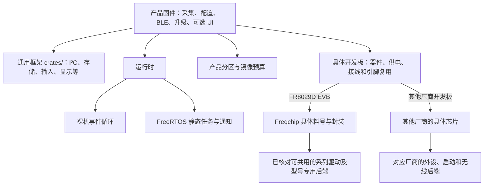

# 多厂商硬件适配架构

MoteFrame 的目标是让同一套采集、配置保存和 BLE 应用可以适配不同厂商的主控。产品固件选择运行方式和功能，开发板描述实际接线，芯片后端提供硬件操作。FR8029D 已按下图装配 MIC1、QSPI 和射频驱动。

| 职责 | 目录 | 换硬件时需要核对 |
|---|---|---|
| 通用接口与算法 | `crates/` | I²C 事务、配置双槽、输入和显示等接口能否由新后端实现 |
| 设备间复用组件 | `devices/crates/` | 选择可复用的 Host 或控制器；提供 HCI 的芯片可对接 Host，直接驱动射频的芯片需适配控制器后端 |
| 芯片支持 | `devices/chips/<厂商>/` | 具体料号、封装、外设实例、中断、ROM、射频校准和 Flash 控制 |
| 开发板 | `devices/boards/<板型>/` | 实装器件、引脚、供电、跳线和互斥资源；同芯片的不同 PCB 可分别登记 |
| FreeRTOS 共用桥接 | `devices/runtimes/freertos/` | 复用静态任务创建和通知。处理器端口、中断优先级和时钟由对应固件配置。 |
| 产品固件 | `devices/firmware/<固件>/` | 组合板级驱动、运行方式和服务；按 Flash 容量、擦除粒度及 ROM 约束核对应用、配置、升级暂存和搬运范围 |

裸机和 FreeRTOS 可共用板级驱动及 GATT 服务，各自接入唤醒与超时等待。FR8029D 的 `0x40000`、`0x41000` 配置槽属于当前 1 MiB 产品布局。现有实现见 [FR8029D 固件和 BLE 架构](../../devices/firmware/fr8029d-bringup/README.md#fr8029d-的-ble-架构)。

## 首个参考实现

移植先查[富芮坤型号能力表](../../devices/chips/freqchip/README.md)，再查[FR8029D 板载功能、实测状态和验收计划](../../devices/boards/fr8029d-evb/README.md)。接入其他厂商时，在对应厂商目录登记料号能力，按实际板型登记资源与验证结果，再由产品固件选用。

MIC1 由 FR8029D 的 SARADC 驱动、EVB 板级配置和固件采集会话组成。固件组装 GATT 回调，裸机和 FreeRTOS 共用这套采集会话。QSPI0 的物理擦写、控制器校验和保护恢复归芯片层。配置 A/B、FlashEnv 和 OTA 范围由固件决定。

FR8029D 射频驱动负责读取出厂校准、初始化调制解调器和基带、访问交换 RAM、提交时隙及确认事件。固件的 `LinkBackend` 适配决定何时发广播、打开接收窗口、应用 PHY 协商结果和恢复链路。各阶段进度及板测条件见[实施顺序与验收](../../devices/boards/fr8029d-evb/README.md#实施顺序与验收)。
