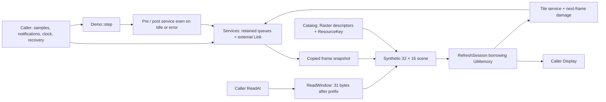

# MoteFrame complete offline integration

This standalone consumer connects normalized button/touch input, a persistent UI
refresh session, immutable source-backed resource descriptors, a read-only storage
window and bounded BLE committed-value handling. It adds no product behavior or
vendor resources. Eight runtime crates, root manifests/lock and frozen core/I²C
baselines are unchanged. No hardware is involved.

## Ownership and boundaries

`UiMemory` owns effective settings and the actual UI pixel scratch. `Demo` borrows
that memory and owns its session, services, immutable catalog and decoder scratch.
The display and reader are temporary independent borrows. All byte/event container
Debug implementations omit stored contents, coordinates, targets and backend internals.
Original adapter errors remain available in step reports; an adapter must redact
its own error type where necessary.

The generic pattern uses program-authored 0/1 mono glyph bytes and an RGB565 strip.
A `ReadWindow` and real `Raster::read_span` execute the reads/decodes. No original
product assets are copied. A button press or normalized tap/swipe selects a swatch;
RX/TX and subscription status have independent markers. There is no application
opcode, service UUID, sensor calculation or product page.

## Scheduling and recovery contract

- Each outer attempt runs services before and after UI regardless of Idle,
  Deferred, NeedsRebind, clock regression, resource failure or display failure.
  Every successful tile adds one service round. A frame uses one copied snapshot;
  tile callbacks post future invalidation without modifying current-frame pixels.
- One round calls poll once, receives at most one complete value, attempts one
  retained notification, processes one retained/raw sample and consumes one
  recognized event. Button/touch event queues alternate including empty turns.
  Adapters supply finite I/O budgets; the example cannot promise radio latency.
- Local Full never overwrites existing bytes/samples. Recognized queue Full retains
  the same popped raw sample and timestamp. Other malformed input is reported and
  explicitly rejected so it cannot poison all subsequent valid input.
- Only errors classified as definitely not queued are retryable automatically.
  An uncertain submission stops on an opaque owner-generation/sequence token and requires exact
  accepted/not-accepted resolution. Invalid backend capacity requires explicit
  repair/retry. Validation TooLong waits for usable capacity without submission.
- Current route identity includes generation, characteristic and bearer. A route
  change or subscription disable retires old pending work. Failed poll prevents
  use of cached RX/TX routes. Empty committed values are valid RX events.
- Resource repair/replacement is identified by a strictly increasing revision.
  Failed updates retain effective settings. Failed frames retain all redraw work;
  display generation/geometry changes require an explicit successful fixed-size
  rebind. Real source content and device state must remain stable for one frame.

Services and model ports assume a single foreground owner. No interrupt, lock,
heap, executor or scheduler framework is introduced. Explicit time values are
monotonic microseconds within a single boot epoch.

## Validation and costs

`make device-foundation` runs host tests, host/ARM Clippy, docs, independent Cargo
graph validation, seeded replay, exact pixels and measured ARM consumers for both
profiles. `make check` includes this gate. The replay exports PPM files and JSON,
then compares both complete image digests and logical observations. It separately
checks expected glyph, strip, swatch and marker pixels.

Tests exercise input-to-pixels, mid-frame snapshot stability, real source windows,
queue pressure, known Full and uncertain acceptance, capacity races, token/route
retirement, resource/display recovery, original first errors and per-round service
bounds under RX flooding. This is software behavior evidence; it does not validate
actual touch coordinates, display timing, a BLE stack or over-air communication.

Two actual profiles use 32/8 UI pixels, 8/2 raw slots, 4/1 slots per recognized queue,
16/8 value bytes and 16/2 asset byte scratch. Both retain full logical semantics.
A small buffer may require more tiles, reads, callbacks or caller retries.

The generated `target/device-foundation/report.json` records source/manifest/lock
hashes, compiler/build settings, executed host checksums, ARM layouts, linked
`.text/.rodata/.data/.bss` and compiler-emitted local frames. Owned storage is:

`UiMemory + Demo<LinkModel> + SourceModel + Sink`

`Demo` already contains the borrowed session, services (including Link/RX/TX/input
arrays), catalog and decoder buffers. Those rows are useful breakdowns and are
**not added again**. Compiler stack frames include construction temporaries and
locals; owner layout totals must not be added to those frames as extra RAM.
The host PPM framebuffer is excluded from the framebuffer-free ARM consumer.

Current Rust 1.96.0 / Cortex-M0 / size-optimized fat-LTO observations:

| Measured item (bytes) | Default | Small memory |
| --- | ---: | ---: |
| UiMemory | 88 | 40 |
| Demo (contains Services/session/catalog/scratch) | 728 | 568 |
| SourceModel | 20 | 20 |
| Sink (no framebuffer) | 24 | 24 |
| Owned layout total, without double count | 860 | 652 |
| Linked Flash (`text + rodata + data`) | 9,443 | 8,911 |
| Static mutable RAM (`data + bss`) | 0 | 0 |
| Workload local frame (not worst call chain) | 2,752 | 2,208 |
| Largest local frame in diagnostic consumer | 2,752 | 2,208 |

The small profile removes 208 bytes from these owners and 532 bytes from this
linked synthetic consumer. The workload frame includes construction/temporary
costs and is larger than the owned layouts; do not interpret a zero static `.bss`
as zero RAM usage. Each profile passes 23 behavior tests and eight executed probe
seeds. The seed-zero replay processes 16 samples/events, accepts 16 notifications,
receives 16 committed values and recovers three explicit fault paths. Full final
PPM SHA-256: `916efc21c034107a648a5fdc9b5765f4aa1d120e54ef3674b7f3c0e11bec86a2`.

These measurements exclude the full firmware, transitive worst call chain, interrupt overlap, real
BLE/Flash pools and hardware behavior. They do not qualify a product RAM budget.

## Delivery

The source delivery includes the standalone example, offline tests and measured
consumer tooling. The user authorized reviewed source integration into main and
GitHub after regression checks. LICENSE and NOTICE accompany the example.
Product adapters, business code, algorithms and vendor/original resources remain
private. Device operations and release publication are outside this delivery.

Owner generations are supplied by the caller to `Services::new` and must never
be reused for coexisting or reconstructed owners in one recovery domain. Tokens
combine that generation with a checked, nonwrapping sequence; no global allocator
is hidden in the example. Real adapters retire their own old committed values and
allocate a new subscription identity even when disable/re-enable occurs between
polls. The synthetic model's `set_enabled` purges its RX source and advances the
route generation; exhaustion keeps the route disabled.

Independent review reproduced and fixed cross-owner stale recovery tokens,
backend RX surviving subscription retirement, and external/reclassified Cargo
targets bypassing standalone validation. Regression tests cover each trigger;
the target allowlist is validated before any app build/test executes. The duplicate
boundary-test definition was removed. The distinct unknown-member-ID and extra
product-member scenarios now have separate names so both execute. An AST check
rejects shadowed test method names before they can hide coverage again.
