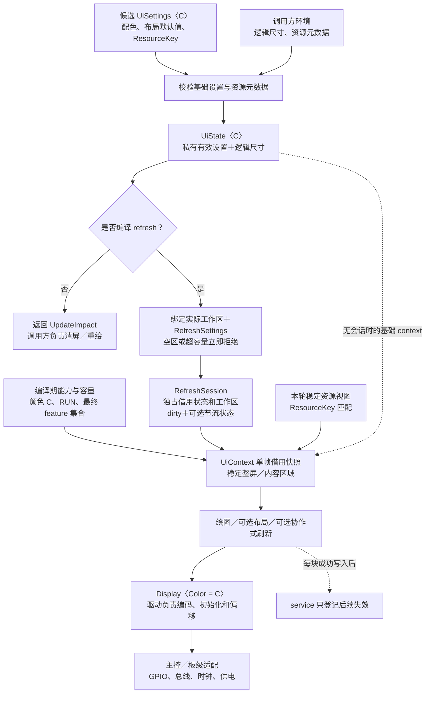
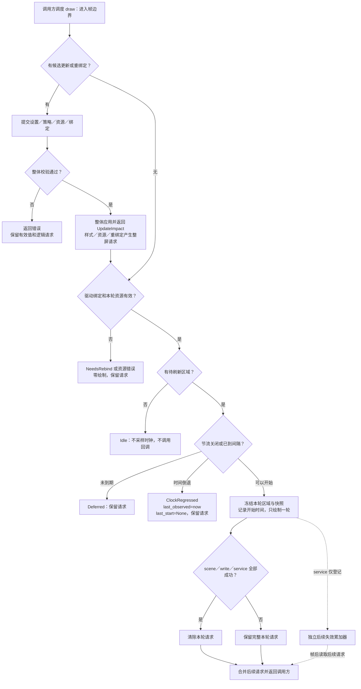

# 通用 UI 配置接口设计修订稿

状态：r0.2，用户已批准并已形成0.2.0 源码候选。本稿保留多角色建议及 U1–U8
设计契约；最终方法、测试和内存结果见 [实现验收记录](ui-configuration-implementation.md)。
接口草图用于表达所有权关系，编译示例以实际 API 文档为准。

颜色类型解耦已有 0.2.0 源码候选，证据见 [颜色接口与内存核算](color-types.md)。
配置接口在同一通用 UI crate 中实现；产品固件、厂商资源和硬件不在本轮范围，
开发和复验阶段的本地限制已由后续明确的 GitHub 提交／推送授权取代；
交付范围见 [进度记录](progress.md)，硬件和私有资源仍在范围之外。

## 设计选择与所有权

采用“轻量状态＋借用式刷新会话＋单帧上下文”。配置对象不持有显示器、字库、
图片或执行器，不依赖主控型号、屏幕协议、操作系统和具体 Flash。

| 单元 | 所有权与职责 |
| --- | --- |
| UiSettings〈C〉 | 候选样式与资源键；字段私有，通过构造器、链式设置与只读 getter 访问 |
| UiState〈C〉 | 持有一份私有有效样式、逻辑尺寸和资源键；不借用设备、资源或工作区 |
| RefreshSettings | refresh 下的候选分块、重绘及可选帧间隔策略，与基础样式分离 |
| RefreshSession〈C〉 | 独占借用 UiState 和调用方工作区；拥有 dirty、有效刷新策略及可选节流状态 |
| UiContext〈C, R〉 | 只在一轮绘制中借用有效设置和资源目录／提供者，给出可绘制区域 |
| ResourceKey | 资源集合标识与修订号，不保存素材内容，不按地址比较 |
| DeferredInvalidation | service 登记后续失效的常量内存累加器：一个矩形并集及整屏标记 |

UiState 的 C 只要求基础配置所需的 Copy 和 PartialEq；实际绘图 API 才要求已有
PixelColor。显示器类型只出现在绘制方法上，约束 `Display<Color = C>`。
不把显示器、时钟和执行器泛型扩散到纯配置对象。

### 配置分层和模块关系图



亮度、旋转、SPI 频率、驱动初始化和供电控制仍属驱动或板级适配。框架不提供
产品页面、默认语言、业务文本、射频或传感器协议。

## 编译期能力与 feature 组合

基础绘图、几何、UiSettings、UiState、ResourceKey 和 UpdateImpact 始终可用。
流式绘图使用 `StreamTarget<D, const RUN: usize = 32>`，RUN 范围为 1 至
65535，在构造使用处做编译期检查，不根据运行时数值申请数组。保留
`StreamTarget::new` 的 32 像素默认推断；显式容量使用 `StreamTarget::<_, RUN>::with_run`。

```toml
# 已实现的功能关系。
[features]
default = ["layout", "refresh", "damage"]
layout = []
refresh = []
damage = ["refresh"]
frame-pacing = ["refresh"]
```

| 最终有效组合 | 额外能力 | 不存在的状态或参数 |
| --- | --- | --- |
| 无可选 feature | 基础绘图、基础配置与更新影响 | 布局字段、session、dirty、工作区要求、节流状态 |
| layout | gap/padding、默认布局辅助 | session、刷新策略、工作区要求 |
| refresh | session、局部重绘、后续失效累加器 | 未启用的布局字段、节流状态 |
| damage 请求 | 自动包含 refresh、明确调用的场景差分 | 无自动差分开关 |
| frame-pacing 请求 | 自动包含 refresh、时间状态与节流参数 | 无具体定时器或 RTOS 依赖 |
| 默认组合 | 布局、刷新、差分 | 默认不含节流 |

字段和 API 由整个目标依赖图中最终启用的 feature 集合决定。Cargo 合并普通
依赖路径的 feature，一条依赖的 `default-features = false` 不能抵消另一条路径
的启用。产品装配须检查最终 feature 集合和链接产物，不能仅看一处声明。
参见 [Cargo 官方合并规则](https://doc.rust-lang.org/cargo/reference/features.html#feature-unification)。

无 refresh 时不保留隐藏 dirty；更新返回影响，由调用方负责绘制。运行时关闭
功能只改变行为，不代表代码裁剪。配置结构内不为关闭模块保留无消费者字段。

## 参数、缺省值与消费优先级 U8

| 参数 | 缺省值或规则 | 实际消费者 |
| --- | --- | --- |
| palette | 显式提供背景、前景、强调、弱化、边框颜色，不要求 C: Default | session 用背景初始化每块，其余角色由 Context 提供给场景 |
| gap | layout 下默认 0 | Context 的默认布局辅助；显式 Stack::new 的 gap 优先 |
| padding | layout 下四边默认 0 | 默认布局辅助计算内容区域；原始显式绘图不受隐式坐标变换 |
| tile_pixels | Auto 或 Fixed〈NonZeroU16〉，默认 Auto | session 构造时 Auto 解析为 min(实际容量, 32)；Fixed 超容量报错 |
| redraw_mode | Dirty 或 FullOnRequest，默认 Dirty | session 在有重绘任务时选择逻辑区域，不表示物理面板提交协议 |
| frame_interval | frame-pacing 下 Unlimited 或 MinimumInterval〈NonZeroU32〉，单位微秒；默认 Unlimited | session 调度前置判断，场景不解释 |
| resources | ResourceKey，空资源使用保留键 | 构造／更新验证元数据，帧前匹配；内容由场景及资源适配层使用 |

优先级为：本次调用显式参数 → Context 默认值 → 表中的基础缺省值。
前景等角色不会自动重写显式绘图颜色。场景没有消费某项默认值时，不声称该项
配置变化必然改变画面。UiSettings 不成为全局主题单例。

Context 的 display_bounds 是整轮稳定的逻辑整屏区域；layout 启用时还提供扣除
padding 的 content_bounds。默认布局必须按这些稳定区域计算，不能按当前 Tile
重新布局。Tile 的 bounding_box 只表示本块裁剪，换 tile_pixels 不应改变最终画面。

RUN 控制流式临时数组，tile_pixels 控制 session 使用调用方工作区的上限，二者
独立。减小 tile_pixels 不缩小已经分配的数组。差分另外需要两整行颜色存储及前后
两个稳定场景，不从小块刷新推断无需额外存储。

首版要求宽高非零，padding 两侧总和严格小于对应尺寸，并检查算术溢出。单个布局
项能否放下仍由布局操作返回错误。FullOnRequest 只响应已有任务，不持续刷屏。
字体大小由字体资源决定；首版不加入没有实际消费者的 font_scale、动画或手势开关。

## 构造、更新与工作区所有权 U1 U5

以下是接口形状草图，省略泛型与完整错误类型，不作为可编译示例：

```text
UiSettings::new(palette) -> 候选设置
UiState::new(settings, dimensions, resource_view) -> Result<UiState<C>, ConfigError>
UiState::settings(&self) -> &UiSettings<C>
UiState::try_update(&mut self, candidate, resource_view) -> Result<UpdateImpact, ConfigError>
UiState::try_rebind(&mut self, candidate, dimensions, resource_view) -> Result<UpdateImpact, ConfigError>
UiState::context(&self, resource_view) -> Result<UiContext, ConfigError>

仅 refresh 下：
RefreshSession::new(&mut ui, &mut scratch, policy) -> Result<Session, ConfigError>
session.try_update(candidate_settings, candidate_policy, resource_view) -> Result<UpdateImpact, ConfigError>
session.try_rebind(candidate_settings, candidate_policy, display_binding, resource_view)
    -> Result<UpdateImpact, ConfigError>
```

基础构造校验几何、样式数值与资源元数据，不要求工作区。session 构造独占绑定
实际可变切片，空区立即返回 EmptyWorkspace，即使没有 dirty 也拒绝；Fixed 大于
实际容量返回 WorkspaceTooSmall，不静默裁小。成功构造 session 时标记整屏。

无 refresh 时可通过 UiState 的 rebind 更新逻辑尺寸，返回 FullRedraw 交由调用方
消费；Context 检查资源键并借用有效设置。基础模式中的实际设备检查和绘制由调用方
负责。session 存续时这些外部可变入口因独占借用不可调用；session 的更新和重绑定
必须同时验证刷新策略与工作区后才整体应用。

session 存续期间，外部不能绕过它更新 UiState、换短切片或让其他任务使用同一
工作区。设置、显示器和切片通过同一个 C 关联。有效字段只读；候选设置、资源元数据
和候选策略全部通过才替换，失败保留旧值、请求及时间状态。候选由调用方临时提交，
不维护配置队列或第二份永久设置。用于样式比较的 PartialEq 必须满足自反性；否则
不能保证同值更新返回 Unchanged，调用方须改用具有稳定值语义的颜色类型。

绘制按次独占借用 `D: Display<Color = C>`，不永久保存设备或资源。工作区要交给
其他任务复用时先结束 session；重建 session 保守整屏重绘，不能假装继承已销毁
的 dirty。首版不提供跨会话迁移 dirty 或中途换工作区。

UpdateImpact 区分 Unchanged、PolicyOnly、FullRedraw。配色、布局或 ResourceKey
变化返回 FullRedraw；仅刷新策略变化返回 PolicyOnly；同值返回 Unchanged；同时
变化以 FullRedraw 为准。session 自动合入重绘影响；无 refresh 时调用方消费返回值。
配置应用成功不等于已经完成绘制，Unchanged 也不能清掉已有请求。

公开设置采用构造器、只读 getter、候选构建方法，避免产品依赖公开 struct 字面量。
可扩展错误／结果枚举使用 non_exhaustive 并提供查询辅助。Rust 内存布局不是稳定
ABI、通信报文或持久化格式，不把结构原样写入 Flash。

## 资源身份、借用与外部存储预留 U4

ResourceKey 使用集合标识与修订号两个 u32；空资源采用保留键，普通集合不使用该键。
一次字体、语言和图片组合由一个键表示。内容、度量或索引规则变化必须改变键；UI
存续期间不把旧键分配给不同内容，计数耗尽时换集合标识或重建状态。

调用方提供 ResourceView〈R〉：键、可立即检查的元数据以及借用的目录／提供者。
构造与资源更新校验请求集合存在、必要度量和尺寸可表示、运算不溢出。相同设置与
已经校验的相同键可跳过重复内容检查；不按地址比较，不要求 R: Eq，也不扫描或
哈希整套字库图片。资源视图的创建必须经过元数据校验入口，不能绕过后标记有效。

每轮 scene 前确认本轮资源键与有效设置匹配，否则返回 ResourceMismatch，零
scene／write／service。UiContext 从第一块到最后一块借用同一视图，旧帧结束后
才能释放或替换它。同地址新修订必须识别为变化。相同键代表相同内容是提供方契约，
框架不能侦测外部存储被其他代码违约改写。

借用目录不要求整套素材已在 RAM。资源适配层可通过捕获的读取器按字形、图片或
小块访问；可变缓存可以变化，但本轮素材内容和索引必须稳定。窗口引用不得超过
读取窗口有效期，不得在下一块复用窗口后继续引用旧内容。首版只需静态视图与参考
实现，不新增具体 Flash、压缩器、缓存替换或资源 OTA。

元数据校验不保证后续读取成功；读取／解码错误沿场景失败路径保留整轮 dirty。
格式和颜色兼容检查由资源适配层负责，不在配置核心加入 RGB565 或厂商素材格式。
配置快照不会自动冻结场景输入：调用方须给整轮稳定场景，service 只收集下一轮
变化，不能悄悄修改当前场景正在读取的数据。

## 显示绑定与尺寸恢复 U2

绘制接收 DisplayBinding：实际驱动与调用方维护的设备代次。session 保存已接受
的尺寸和代次，每轮在 scene／write 前检查。代次不是硬件寄存器地址；换设备、外部
复位或使显示内容失效的旋转／重初始化，即使尺寸相同，也必须换代次并显式 rebind。
UI 存续期间不得把旧代次复用于另一显示状态。

Session::new 成功后绑定状态为 Unbound。首次 draw 先验证实际尺寸与 UiState
一致、资源键及工作区有效，全部通过才接受初始代次，转为 Bound；不因此修改节流
锚点。初始资源或策略校验失败保持 Unbound；一旦观察到尺寸失配则进入 NeedsRebind，
不能靠再次 draw 自动解除。首次 draw 前也可显式 try_rebind 接受一个有效绑定。

首版拒绝零宽／零高。发现尺寸或代次变化后进入 NeedsRebind，保留逻辑请求并停止
使用旧几何写屏；无 dirty 时也检查绑定，不能把换屏当作 Idle。一轮同步刷新期间
尺寸及驱动命令状态必须稳定。

try_rebind 在帧边界统一校验候选设置、新几何、当前工作区与资源。成功才替换
绑定和设置、重建 dirty，以新尺寸整屏请求覆盖旧坐标请求；设置同值也返回
FullRedraw。失败保留旧有效设置和逻辑需求；已经观察到外部尺寸／代次失配时维持
NeedsRebind，未观察到环境变化时不主动破坏原有效绑定。不能承诺回滚已在外部改变
的驱动，调用方须恢复有效驱动绑定或提交有效新候选。

变为零尺寸走相同恢复协议；恢复有效尺寸后再次绑定。原地 rebind 不清空节流锚点，
避免它成为绕过间隔的隐式手段；新建 session 则是明确的新调度生命周期。

## 调度与帧间隔状态机 U3

frame-pacing 启用时持有 `last_start: Option<u64>` 与
`last_observed: Option<u64>`，表示同一时钟纪元的微秒；零是合法时间。
调用方提供有界时钟回调，不依赖硬件定时器、RTOS 或 std::Instant。禁用节流、
无 dirty 或前置校验失败时，不调用该回调。

启用功能不会改变原有 draw 的签名。带时钟调用使用 draw_timed；普通 draw
遇到有任务且需节流的策略时返回 ClockRequired，不能绕过时间限制。
首版时钟回调为不可失败的 `FnMut() -> u64`，不返回 Result。平台无法提供时间时，
调用方先处理读取失败而不发起本轮绘制；本稿不虚构 ClockError 恢复接口。

每次最多一轮：环境和资源校验 → dirty 判断 → 节流判断 → 冻结区域与上下文 →
首次 scene 前记录开始时间 → 绘制 → 合并后续请求。Idle、Deferred 均不调用
scene／write／service。通过差值比较间隔，不以可能溢出的加法计算绝对截止时间。

| 事件 | 时间状态变化 | 请求和结果 |
| --- | --- | --- |
| 首次启用节流 | 两者 None | 首个有效且有 dirty 的调用立即可开始 |
| 无 dirty | 不采样、不改状态 | Idle |
| 设置、工作区、绑定或资源无效 | 不改时间状态 | 明确错误、零绘制，保留请求 |
| now 小于 last_observed | last_observed=now，last_start=None | ClockRegressed，当次零绘制，保留请求 |
| 时间合法但未到间隔 | last_observed=now，last_start 不变 | Deferred〈remaining_us〉，保留请求 |
| 真正开始一轮 | 首次 scene 前两者置为 now | 成功或后续失败均保留该开始时间 |
| Unlimited 期间 | 不采样，锚点保持 None | 有任务且环境有效即可开始 |
| 有效更新关闭节流 | 清空两个锚点 | 不额外请求绘制 |
| 有效更新重新启用 | 两者 None | 与首次启用一致 |
| 非零间隔改为另一个非零值 | 保留两个锚点 | 下次按新间隔与原 last_start 判断 |
| 同值更新，或只改样式／资源 | 不重置锚点 | 不通过更新绕过节流 |

时间回退按新纪元处理：当次报错并清空开始锚点，下次非递减读数即可恢复，不等待
旧时间追平。这是明确的恢复性状态变化，不与无效配置“不改变状态”混同。u64 回绕
也视作纪元变化，不用无符号环绕差值。

验收：间隔 10，t=100 开始后传输失败；101 Deferred；110 开始重试；90
ClockRegressed；91 可开始。逐步断言时间、dirty 和回调计数，另覆盖 Some(0)、
禁用再启用、无 dirty，以及同值更新不会重置锚点。

## 后续请求合并与更新流程 U7

session 区分本轮请求与 DeferredInvalidation。后者仅保存裁剪后的一个矩形并集
和整屏标记，不维护无界队列。service 只能登记后续请求，不能修改本轮 dirty、
配置、资源和绑定；回调自身的工作量由调用方限制。

service 显式接收后续失效 sink 的可变借用；该 sink 只暴露登记区域／整屏的方法，
不暴露 session 或 UiState。无效或不可见区域忽略，区域按本轮绑定尺寸裁剪。

成功时清除本轮请求再合并后续请求；失败时保留完整本轮请求并合并后续请求。
末块后的 service 失败也走失败路径。一次 draw 结束就返回调用方，不在内部继续
消费新请求，因此持续到来的事件不能让本次绘制永不结束。



绘制期间到达的配置变更由调用方帧后提交，不增加内部候选事件队列。无 refresh
构建止于 UpdateImpact；低层显式绘图 API 继续可用，不强迫全局状态。失败后的重试
仍经过绑定、资源和节流检查。

## 扩展边界与首版取舍

| 方向 | 首版采纳／预留 | 明确延后 |
| --- | --- | --- |
| API 演进 | 私有有效字段、构造器、getter、可扩展结果分类 | 稳定内存 ABI、原样持久化、跨版本反序列化 |
| 多产品／多屏 | 同颜色可复用候选样式；每屏独立状态、session 和绑定 | 多屏注册表、跨颜色自动转换 |
| 外部 Flash 素材 | 资源键、借用目录、小窗口有效期与读取失败路径 | 具体 Flash、缓存算法、压缩和 OTA |
| 异步／DMA／电子纸 | 纯配置、资源键和几何校验可复用，未来提供并列执行接口 | 万能后端、把同步 write 偷换成已排队、隐式面板提交 |
| 中断／其他任务 | 调用方有界邮箱或整屏标记，UI 所有者在帧边界合并 | 配置对象内的跨线程锁、无界队列、中断直接修改当前 dirty |
| 输入／动画／缩放 | 保留模块边界，有真实消费者再增加参数 | 无效手势阈值、动态插件、全局主题服务 |

有界邮箱溢出可保守升级为整屏失效，不能静默丢失；跨任务同步由适配层保证。
同步成功仍要求本轮 scene、同步 write、service 全部成功，并允许安全复用已返回
的像素工作区，但不自动保证面板物理刷新已完成。

未来异步接口另定缓冲区保留、传输完成、面板完成、取消和错误语义，不复用同步
测试结论。配置层不为此依赖某个执行器，也不预置暂时没有消费者的功能开关。

## 内存与裁剪核算 U6

预算分开记录有效设置／状态、资源目录／句柄、调用方工作区、临时绘图数组、驱动
和场景调用链、静态资源 ROM。静态借用不等于没有元数据或调用栈开销。

- 流式数组为 RUN × size_of〈C〉，按实际实例核算。
- session 工作区为实际数组容量 × size_of〈C〉，不能用 tile_pixels 替代。
- 差分为 2 × width × size_of〈C〉，与小块工作区分开核算。
- Context 借用设置，不复制素材；候选值与嵌套临时值仍计入峰值。
- 节流关闭构建不含时间字段；启用后的两个 Option〈u64〉及对齐要实测。
- 同一缓冲区只计一次，不能把所有局部帧相加冒充最坏调用链。

固定目标、编译器、优化与链接条件，对不同消费者测量 size_of、
.text/.rodata/.data/.bss 和已知静态调用链。包文件列表不证明最终 Flash 裁剪。
已有颜色数组结果仅作基础参考，不能冒充新配置接口的内存证明。

## U1–U8 设计处理与离线验收矩阵

| 问题 | 本稿设计处理 | 后续验收 |
| --- | --- | --- |
| U1 配置／容量绑定 | 状态与 session 分离，实际切片独占借用，候选整体校验 | 空区、Fixed 超容量、颜色混用编译失败、不能绕过更新、失败零写屏 |
| U2 尺寸恢复 | NeedsRebind、统一重绑定、成功全屏、拒绝零尺寸 | 扩大／缩小、同尺寸新代次、无效 padding、旧几何停写、恢复路径 |
| U3 节流状态 | 两个 Option 锚点及开始／失败／启停／倒退规则 | 100→101→110→90→91、合法零时间、同值更新、Idle 零时钟调用 |
| U4 资源生命周期 | 集合和修订号、帧借用、元数据与读取错误分层 | 同址新版本、键不匹配零绘制、借用期间释放编译失败、目录小窗口适配 |
| U5 关闭刷新 | 基础 UpdateImpact，只有 session 维护 dirty 和工作区 | 基础、layout、refresh、damage、pacing 的最小消费者 |
| U6 有效裁剪 | 明确 feature 合并与依赖，核算最终产物 | 默认、无默认、仅 damage、两路径合并，字段／API／链接段对照 |
| U7 请求归属 | 任务和时间判断、两代请求、帧后合并、最多一轮 | 首／末块新请求、本轮成功及任一错误均不丢请求、持续请求不使 draw 无界循环 |
| U8 默认消费 | 显式参数优先，Context 稳定区域与默认辅助，session 消费背景 | 默认 gap／背景随配置变化、显式覆盖保持、不同 tile_pixels 同画面、非消费者不虚构变化 |

还须有公共 API 的编译失败样例、feature 消费者矩阵，场景、显示、资源访问、
service 和元数据错误注入，以及时钟回退序列。此表是验收要求；实际覆盖和限制见实现验收记录，不把设计表本身当作测试结果。

## 多角色建议采纳记录

| 来源 | 首版采纳 | 预留／延后 |
| --- | --- | --- |
| Rust API／扩展性角色 | 状态、session、Context 分离，资源键，更新影响，消费优先级 | 并列异步接口，不把后端泛型扩散到配置 |
| 资源／内存／裁剪角色 | 目录借用、按需读取边界、实际工作区绑定、feature 矩阵、分项预算 | 存储、缓存、压缩、持久化 |
| 调度／恢复／可测试性角色 | NeedsRebind、拒绝零尺寸、确定时间状态机、后续请求常量内存合并 | 跨中断通道和面板提交协议 |
| 主审综合 | 同尺寸换屏代次、稳定场景输入、颜色比较契约、明确工作区复用代价 | 跨 session 保留 dirty 的更细借用接口，待实际共享内存需求再设计 |

本稿选择小工作区的独占借用以明确首版容量和生命周期；调用方轮流复用该内存时
需接受重建 session 的整屏代价。没有提前加入持久化、万能后端或资源加载引擎。
U1–U8 的设计处理与实现证据分别维护，开发步骤及离线故障注入结果见实现计划与验收记录。
